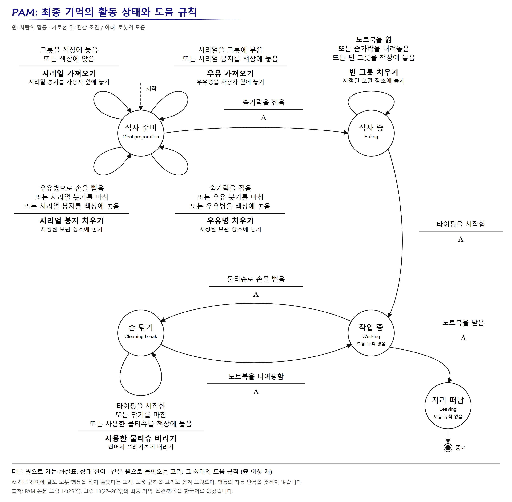
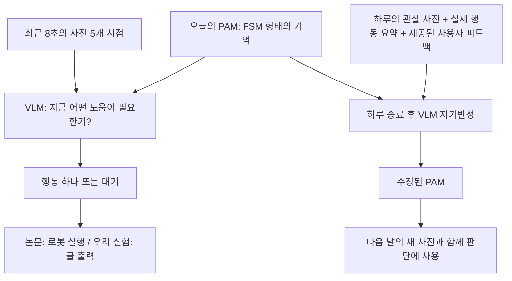
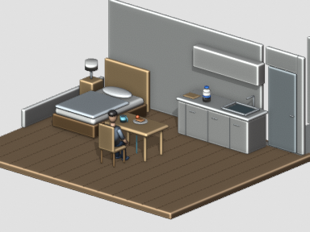
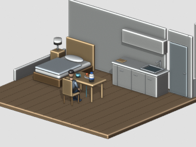

# PAM 기반 아침 식사 행동 판단 실험

이 프로젝트는 **사용자가 요청하기 전에 언제, 무엇을 도와야 하는지** 판단하는 PAM 논문을 아침 식사 상황에 적용합니다. 사람이 식탁에 앉았을 때 우유가 필요하면 가져오고, 식사가 끝나고 실제로 외출한 뒤 사용한 컵·접시가 남아 있다면 정리하는 상황을 다룹니다. 실제 로봇을 움직이는 대신 **선택한 행동을 글로 출력**합니다.

핵심은 사진 한 장에 물건이 있는지만 찾는 것이 아닙니다. **최근 사진과 그 사람의 습관을 담은 기억을 함께 읽어 행동을 판단하고, 하루가 끝나면 관찰 기록으로 기억을 수정해 다음 날 사용**합니다.

> 현재 폴더에는 사진 준비, 행동 판단, 기억 생성·갱신, 다음 날 기억 적용을 위한 핵심 코드가 있습니다. 현재 식탁 시작 설정에서는 우유 유무 두 장면의 실제 판단을 실행했습니다. **현재 설정으로 자기반성까지 연결한 전체 순환 실험과 식기 정리 실험은 아직 완료하지 않았습니다.**

이 문서는 먼저 논문의 문제와 동작 원리를 설명하고, 그 아래에 논문의 한계를 정리합니다. 이후 우리 환경의 변경점, 실제 결과, 폴더 구성과 실행법을 설명합니다.

- 논문: **An Agentic Framework for Proactive Robots with Procedural Assistance Memory**, Dohyun Lee, Minho Park 외, KAIST AI, CoRL 2026. [논문 보기](https://arxiv.org/abs/2610.21211)
- 저자 공개 자료: [DAVIAN-Robotics/PAM](https://github.com/DAVIAN-Robotics/PAM)
- 검토 기준: 제공받은 논문 v1과 공개 저장소 버전 `656a63ef4607177dd3b404042086486531a573f4`
- 이 프로젝트는 저자의 공식 실행 코드가 아니라, 논문·부록에 근거해 작성한 상황 변경 구현입니다. [출처 구분](THIRD_PARTY.md) · [상세 검증 보고서](docs/논문충실도_검증보고서.md)

## 추가 연구 검토 — 사용자 반응과 역계획

사용자가 직접 한 일과 도움 이후 행동을 해석해 PAM의 도움 규칙을 생성·수정하는 방식을 검토합니다. **2026-11-02 현재 실제 촬영본 10편의 내용을 확인했으며, 역계획 구현·촬영본의 모델 실행·성능 비교는 아직 하지 않았습니다.** 행동 직전의 역계획 적용은 이번 범위에서 미룹니다.

- [현재 연구 방향과 비교 계획](docs/research/개인별선호모델_연구방향.md): 적용 위치, 기존 코드와의 차이, 비교 조건과 미정 사항
- [영상 목록과 확인 근거](docs/research/video_inventory_2026-11-02.json): 로컬 파일 11개 중 중복 한 쌍을 제외한 촬영본 10편의 내용과 평가용 촬영 의도
- [11월 1일 개인별 선호 모델 제안 자료](docs/presentations/PAM_개인별선호모델_발표자료.md): 이전 논의를 정리한 자료이며 현재 촬영의 결과 보고서가 아닙니다.
- [팀의 검토 티켓](https://github.com/2026-SWE/docs/blob/main/03_Sprints/Sprint-01/Tickets/S01-PSJ-01_선제적-도움의-간섭도와-개인화-방식-검토.md) · [일일 진행 기록](https://github.com/2026-SWE/docs/blob/main/03_Sprints/Sprint-01/Daily/PSJ.md)

## 1. 논문이 해결하려는 문제

**논문의 예시는 책상 위에 놓인 빈 그릇입니다.**

| 논문에 나온 상황 | 필요한 도움 |
|---|---|
| 사용자가 이제 식사하려는 상황 | 시리얼을 가져다주기 |
| 사용자가 식사를 마친 상황 | 빈 그릇을 치우기 |

논문 **§3.2, 4쪽**은 같은 빈 그릇이 책상에 있어도, 식사를 시작하려는지 이미 끝냈는지에 따라 시리얼을 가져오거나 그릇을 치워야 한다고 설명합니다. **현재 보이는 물건뿐 아니라 사용자의 활동 단계가 있어야 필요한 도움을 구분할 수 있습니다.**

논문 **그림 1, 2쪽**은 아침에 그릇을 들고 온 사용자를 예로 듭니다. 일반적인 의도 추정만으로는 오트밀·시리얼·요거트 중 무엇을 원하는지 모호합니다. 하지만 **이 사용자가 최근 아침으로 시리얼을 먹어 왔다는 기억**이 있으면 시리얼을 가져다주는 도움을 선택할 수 있습니다.

따라서 논문의 접근은 **사용자의 활동 단계와 반복 행동을 기억하고, 현재 관찰을 그 맥락에서 해석해 언제 무엇을 도울지 결정하는 것**입니다. 위 설명은 원문 예시를 한국어로 풀어 쓴 것이며, 우리 실험의 우유·컵·접시 상황은 뒤의 「우리는 어떤 환경에 적용했는가?」에서 설명합니다.

## 2. PAM, FSM, VLM은 각각 무엇인가?

| 용어 | 쉬운 설명 | 역할 |
|---|---|---|
| **PAM** — Procedural Assistance Memory | 언제 어떤 도움을 주면 되는지 저장한 절차 기억 | 개인의 활동 단계, 도움 조건, 행동, 단계 연결을 보관 |
| **FSM** — Finite-State Machine, 유한 상태 기계 | 활동을 몇 개의 상태로 나누고 사건에 따라 다음 상태로 연결하는 구조 | PAM을 정리하는 형식 |
| **VLM** — Vision-Language Model, 시각·언어 모델 | 사진과 글을 함께 이해하는 모델 | 최근 사진과 PAM을 읽어 행동을 선택하거나 기억을 수정 |
| **VLA** — Vision-Language-Action 모델 | 사진과 지시문을 바탕으로 로봇 동작을 만드는 모델 | 논문의 실제 로봇 실행 담당. 우리 실험에서는 사용하지 않음 |

**PAM은 기억이고, FSM은 그 기억의 구조이며, VLM은 그 기억과 사진을 읽는 모델입니다.** 세 용어를 같은 뜻으로 쓰면 안 됩니다.

### FSM 안에 무엇이 들어가는가?

**원은 상태, 화살표는 상태 사이의 전이, 화살표의 글은 전이 조건**입니다. 네트워크 수업의 rdt(신뢰적 데이터 전송 프로토콜)에서 배운 상태 그림과 같은 방식으로 읽으면 됩니다.

아래는 **논문의 5일차 최종 기억인 그림 14(25쪽)와 그림 18(27–28쪽)의 다섯 상태·다섯 전이를 rdt 강의 그림 방식으로 표시한 것**입니다. **여섯 도움 규칙도 전부 해당 원에 연결된 고리 화살표로 표시**했습니다. 식사 준비 원에 네 개, 식사 중 원에 ‘빈 그릇 치우기’, 손 닦기 원에 ‘사용한 물티슈 버리기’가 있습니다. 각 고리의 가로선 위는 관찰 조건, 아래는 로봇이 해줄 일입니다. 우리 아침 식사 실험의 상태와는 구분합니다.

> **그림 3과 최종 기억의 차이:** 본문 그림 3에는 노트북 타이핑이 `Cleanup → Eating`으로 표시되어 있지만, 최종 기억인 그림 14·18에서는 `cleaning_break → working`입니다. 여기서는 최종 기억을 기준으로 **손 닦기 → 작업 중**으로 표시합니다. 저자의 의도나 오기 여부는 확인되지 않았으며, 두 자료가 다르다는 점을 구분합니다.



[그림 크게 보기](docs/diagrams/pam-fsm-rdt.png) · [벡터 그림](docs/diagrams/pam-fsm-rdt.svg) · [편집 가능한 HTML 원본](docs/diagrams/pam-fsm-rdt.html)

| 그림의 표시 | 뜻 | 논문 최종 기억의 예시 |
|---|---|---|
| 원 | 사용자의 활동 상태 | 식사 준비, 식사 중, 작업 중, 손 닦기, 자리 떠남 |
| 다른 원으로 가는 곡선 화살표 | 해당 조건이 관찰되었을 때 연결되는 다음 활동 상태 | 사람이 숟가락을 집음 → 식사 준비에서 식사 중으로 전이 |
| 같은 원으로 돌아오는 자기고리 | 그 상태에 저장된 도움 규칙을 설명하기 위한 표시. 새로운 상태 전이를 추가한 것이 아님 | 식사 준비 상태에서 사람이 그릇을 책상에 놓거나 책상에 앉음 → 시리얼 가져오기 |
| 가로선 위의 조건 / 아래의 행동 | 어떤 관찰을 계기로 어떤 도움을 주는지 | 그릇을 책상에 놓음 또는 책상에 앉음 / 시리얼 가져오기 |
| 점선 시작 화살표·이중 원 | 그림의 시작·종료 표시. 추가 활동 상태가 아님 | 시작은 식사 준비, 종료는 자리 떠나기 이후 |

**Λ(람다)는 이 그림에서 해당 전이에 별도 로봇 행동을 적지 않았다는 표시입니다.** 최종 기억은 상태 전이에 조건을 저장하고, 도움 행동은 상태별 규칙에 따로 저장하므로 이렇게 표시했습니다. 모델이 실제로 출력하는 ‘대기’를 뜻하는 기호는 아닙니다.

그림을 읽으면, 식사 준비 상태에는 **‘사람이 그릇을 책상에 놓거나 책상에 앉으면 시리얼을 가져오기’**라는 도움 규칙이 있습니다. 이후 **숟가락을 집으면 식사 중**, **타이핑을 시작하면 작업 중**으로 이어집니다. 작업 중에 물티슈로 손을 뻗으면 손 닦기 상태로, 손을 닦은 뒤 노트북을 타이핑하면 다시 작업 중으로 돌아갑니다. **타이핑을 식사 재개로 해석하는 것이 아닙니다.**

rdt 그림은 보통 화살표에 **‘발생한 사건 / 실행할 동작’**을 함께 적습니다. 이 설명 그림도 그 표기법을 사용하되, **논문의 상태 안에 있던 도움 규칙은 자기고리로 옮겨 표시**했습니다. 실제 PAM은 상태별 도움 규칙과 상태 전이 조건을 별도로 저장합니다. 자기고리는 같은 행동을 자동으로 반복한다는 뜻이 아니며, **시리얼을 가져오는 것 자체가 식사 중으로 넘어가는 조건도 아닙니다.**

**상태만 보는 것이 아니라, 그 상태에서 어떤 관찰을 계기로 어떤 도움을 주는지 함께 봐야 합니다.** 논문 최종 기억의 도움 규칙 여섯 개는 다음과 같습니다. 각 행에서 ‘또는’으로 연결된 조건 중 하나가 관찰되면 도움 후보가 되며, 실제 판단 모델은 현재 맥락과 즉시 실행 가능성도 함께 확인합니다.

| 현재 상태 | 사람이 보이는 행동 — 조건 | 로봇이 제공할 도움 |
|---|---|---|
| 식사 준비 | 그릇을 책상에 놓음 **또는** 책상에 앉음 | 시리얼 봉지를 집어 사용자 옆에 놓기 |
| 식사 준비 | 시리얼을 그릇에 부음 **또는** 시리얼 봉지를 책상에 놓음 | 우유병을 집어 사용자 옆에 놓기 |
| 식사 준비 | 우유병으로 손을 뻗음 **또는** 시리얼 붓기를 마침 **또는** 시리얼 봉지를 책상에 놓음 | 시리얼 봉지를 지정된 보관 장소에 놓기 |
| 식사 준비 | 숟가락을 집음 **또는** 우유 붓기를 마침 **또는** 우유병을 책상에 놓음 | 우유병을 지정된 보관 장소에 놓기 |
| 식사 중 | 노트북을 엶 **또는** 숟가락을 내려놓음 **또는** 빈 그릇을 책상에 놓음 | 빈 그릇을 지정된 보관 장소에 놓기 |
| 손 닦기 | 타이핑을 시작함 **또는** 닦기를 마침 **또는** 사용한 물티슈를 책상에 놓음 | 사용한 물티슈를 쓰레기통에 버리기 |

**‘식사를 마침’은 어떻게 표현되는가?** 이 최종 기억에는 별도의 ‘식사 완료’ 상태가 없습니다. 식사 중 상태 안에서 숟가락을 내려놓거나 빈 그릇을 책상에 놓는 등의 단서를 보고 **빈 그릇 정리**를 판단합니다. 그 뒤 타이핑을 시작하면 작업 중 상태로 연결됩니다. ‘식사 완료’를 독립 상태로 만드는 설계도 가능하지만, 논문 최종 기억의 구조와는 구분해야 합니다.

**왜 ‘손 닦기’라는 상태가 필요한가?** 로봇이 사람의 손을 닦아준다는 뜻이 아닙니다. 사람이 물티슈를 사용하는 짧은 활동을 따로 기억해, **물티슈 사용 후 다시 타이핑하는 상황**을 다른 타이핑 상황과 구분하기 위해 추가되었습니다. 논문 C.2절(23쪽)과 그림 17(27쪽)은 반성 모델이 작업 중 상태에 물티슈 처리를 합칠지 검토한 뒤 별도 단계로 나눈 이유를 설명합니다. 그 단계에서 제공하는 도움은 **사용한 물티슈 버리기**입니다.

**작업 중에는 무엇을 도와주는가?** 그림 18의 최종 기억에서 작업 중 상태의 `rules`(도움 규칙 목록)는 비어 있습니다. 자리 떠남 상태도 같습니다. 이는 그 상태에 등록된 도움이 없다는 뜻이지, 로봇이 그 상태를 지울 수 있다거나 모든 상태에 반드시 도움을 하나씩 만들어 넣어야 한다는 뜻이 아닙니다. 작업 중 상태는 손 닦기와 자리 떠남으로 이어지는 맥락을 제공합니다. 새로운 도움을 추가하려면 사용자의 실제 반복 행동이나 피드백이 근거가 되어야 합니다.

**‘식사를 마치면 물티슈 가져오기’와는 어떻게 다른가?** 그런 도움을 설계할 수 있습니다. 실제로 부록 **그림 19(28쪽)의 목록형 기억**에는 타이핑·키보드 위 손·식사 종료를 조건으로 물티슈 묶음을 가져오는 규칙 문장이 실려 있습니다. 그러나 그림 19는 상태 구분 없는 **별도의 비교 방법**이며, 여기서 설명하는 그림 18의 최종 FSM 기억에는 그 규칙이 없습니다. 또한 본문 그림 4의 여섯 평가 행동은 ‘사용한 물티슈 버리기’를 포함하며 ‘물티슈 가져오기’는 포함하지 않습니다. 따라서 부록에 생성된 규칙 문장이 있다는 사실을 그 행동이 최종 FSM이나 평가 행동 집합에 포함된 것으로 해석하지 않습니다.

PAM은 이 구조를 JSON이라는 구조화된 글로 저장합니다. 실제 필드인 `initial_state`는 시작 상태, `states`는 활동 단계, `rules`는 도움 조건과 행동, `next`는 다음 단계로 넘어가는 조건을 뜻합니다. 한 상태에 도움 규칙이 없을 수도 있고 여러 개일 수도 있습니다.

다만 논문에서는 프로그램이 현재 상태 하나를 확정하고 조건문만 실행하는 방식으로 행동을 고르지 않습니다. **VLM이 FSM 형태로 적힌 기억 전체와 최근 사진을 함께 읽고, 현재 상황에서 적절한 행동을 선택합니다.** FSM은 판단에 참고할 활동 맥락을 제공합니다.

## 3. 전체 동작: 낮에 판단하고, 하루 종료 후 기억을 고친다



하루 관찰과 **실제로 일어난 행동**을 기록해 자기반성 입력으로 사용합니다. 우리가 글로 출력한 행동 제안은 로봇이 실제로 수행한 행동으로 기록하지 않습니다.

### 낮: 사진과 기억으로 행동을 선택한다

1. **최근 사진을 준비합니다.** 현재에서 8초 전, 6초 전, 4초 전, 2초 전, 현재의 다섯 시점을 가져옵니다. 같은 시점의 좌·우 카메라 사진을 가로로 붙이므로, 모델 입력은 결합 사진 5장이고 카메라 원본으로는 10장입니다.
2. **사진과 PAM을 함께 보냅니다.** 여기에 가능한 행동 목록과 판단 지시문을 전달합니다. 평가용 정답은 보내지 않습니다.
3. **VLM이 도움의 필요성과 실행 가능성을 해석합니다.** 사진에서 보이는 사람·물건·행동을 기억의 활동 맥락과 함께 읽습니다.
4. **행동 하나 또는 대기를 출력합니다.** 응답 형식을 검사하고 행동 번호를 읽을 수 있는 문장으로 표시합니다.

논문은 판단과 자기반성에 Qwen3.5-27B를 사용합니다. 판단에서는 추가 추론 기능인 Thinking을 끄고, 자기반성에서는 켭니다. 우리 구현도 이 설정을 요청합니다. OpenRouter는 이 모델을 내려받지 않고 원격으로 호출하는 연결 서비스입니다.

다음은 식탁에 앉은 사람을 판단하는 예시입니다.

| 사진에서 올바르게 해석해야 할 상황 | PAM의 도움 조건과 연결 | 기대 행동 |
|---|---|---|
| 식탁에 앉았고 곁에 우유가 없으며 우유를 잡고 있지 않음 | 우유를 제공할 조건 충족 | 우유 가져오기 |
| 식탁에 앉았고 우유가 이미 곁에 있음 | 우유가 없다는 조건 불충족 | 대기 |

이 표는 **기대 행동**입니다. 실제 모델이 두 경우를 모두 정확히 구분한다는 보장은 없으며, 우리 실행에서 나온 실패는 아래 결과에 공개합니다.

모델 응답의 `observation`은 관찰 설명, `reasoning`은 짧은 판단 근거, `task_index`는 선택한 행동 번호입니다. `-1`은 대기입니다. 응답이 깨졌거나 잘렸다면 대기로 바꾸지 않고 오류로 기록합니다.

### 하루 종료 후: VLM이 자기반성으로 PAM을 갱신한다

‘밤에 자기반성한다’는 것은 하루 활동이 끝난 뒤 기록을 검토한다는 쉬운 표현입니다. 특정 시각에 자동으로 실행된다는 뜻은 아닙니다.

자기반성용 VLM에는 다음 자료가 들어갑니다.

| 입력 | 목적 |
|---|---|
| 하루 기록에서 균일하게 뽑은 사진 | 사람이 실제로 어떻게 행동했는지 관찰 |
| 오늘 사용한 PAM | 기존 도움 규칙과 활동 구조 확인 |
| 사람·로봇 행동의 시간순 요약 | 실제로 누가 어떤 일을 했는지 제공 |
| 사용자 피드백이 있다면 함께 | 사용자가 원하거나 원하지 않는 도움을 반영 |

논문 설정은 **200개 시점**입니다. 처음 기억을 만들 때는 관찰 사진만으로 시작하고, 기존 기억·행동 요약·피드백을 사용하는 갱신과 구분합니다.

자기반성의 질문은 단순히 ‘오늘 무엇을 했는가?’가 아닙니다. **‘사람이 직접 한 일 중 로봇이 미리 대신할 수 있었던 것은 무엇이며, 다음에는 어떤 관찰을 계기로 도와야 하는가?’**입니다.

논문 §3.3의 예시를 풀면 다음과 같습니다.

```text
관찰: 사람이 빈 그릇을 꺼낸 뒤 직접 시리얼을 붓는다.
검토: 그 사람이 시리얼을 가져오는 일을 미리 도울 수 있었는가?
새 규칙 후보: 빈 그릇을 꺼내면 → 시리얼을 가져다준다.
```

부록의 지침은 실제로 관찰된 물건 이동에 근거할 것, 로봇이 도와줘도 사람이 계속 만들어낼 관찰 신호를 사용할 것, 오늘 나타나지 않았다는 이유만으로 기존 규칙을 삭제하지 말 것 등을 요구합니다. 사용자가 이미 우유를 집기 시작한 뒤 같은 우유를 가져오려는 조건처럼, 선제적 도움의 목적에 맞지 않는 조건을 피하도록 지시합니다. 사용자 피드백이 있으면 우선합니다.

출력은 감상문이 아니라 **수정된 PAM 전체**입니다. 활동 상태, 도움 조건과 행동, 상태 사이의 연결을 추가·수정할 수 있습니다. 모델의 가중치를 다시 학습하는 것이 아니라 모델이 읽을 외부 기억을 고칩니다. 별도의 학습 손실함수로 규칙을 최적화하는 방법은 논문에 제시되어 있지 않으며, 공개 프롬프트의 지침에 따라 VLM이 갱신합니다.

### 다음 날: 갱신된 기억을 다시 읽는다

PAM은 하루 동안 고정하고, 하루 종료 후 만든 새 기억을 다음 날부터 사용합니다. 새 사진을 읽는 과정은 같지만 참고하는 기억이 달라집니다.

저자 공개 자료의 기억 변화 예시는 다음과 같습니다.

| 기억 | 시리얼을 가져오는 조건 |
|---|---|
| 1일차 공개 예시 | 사람이 그릇을 책상에 놓음 |
| 2일차 공개 예시 | 사람이 그릇을 책상에 놓음 **또는 책상에 앉음** |

같은 2일차 예시에는 **시리얼을 그릇에 부으면 우유를 가져오기** 규칙도 추가됩니다. 이는 저자의 공개 기억 예시이며, 우리 실험에서 학습한 결과가 아닙니다.

기억 수정 후에도 올바른 행동이 나오는지는 별도로 확인해야 합니다. 규칙을 고쳤다는 사실만으로 성능이 좋아졌다고 판단하지 않습니다. 기록상 변경할 근거가 없다면 기억을 유지하는 것도 가능한 결과입니다.

## 4. 논문의 한계

### 저자가 직접 밝힌 한계 — 논문 9쪽, Limitation

**관찰된 행동이 실제 의도를 뜻하지 않을 수 있습니다.** 사용자가 학습된 도움 조건에 관련된 물건을 잠깐 다루기만 해도, 모델은 다음 활동을 시작했다고 해석하고 도움을 제공할 수 있습니다. 실제로는 아무 행동도 하지 않는 편이 맞는 상황에서 불필요하게 개입하는 문제가 생깁니다.

**애매할 때 사용자에게 확인하는 기능이 없습니다.** 저자는 이런 상황에서 바로 행동하기보다 사용자에게 물어보는 것이 적절할 수 있지만, 질문으로 확인하는 기능은 현재 프레임워크의 범위 밖이라고 명시합니다. 우리가 이해할 때도 ‘PAM이 모든 모호함을 없앤다’고 받아들이면 안 됩니다.

**새로운 물건·공간 배치·사용자에 대한 일반화 검증이 제한되어 있습니다.** 저자는 현재 공개 VLA의 능력 제약 때문에 평가가 이미 본 시나리오에 제한됐다고 밝힙니다. 이것이 모든 새로운 상황에서 반드시 실패한다는 뜻은 아니지만, 실제 다양한 가정에 바로 적용할 수 있음을 증명한 것도 아닙니다.

### 실험 설계와 방법을 읽고 추가로 고려할 점 — 이 프로젝트의 해석

아래는 저자의 한계 문장을 그대로 옮긴 것이 아니라, 원문 조건을 바탕으로 한 검토입니다.

| 검토할 점 | 원문 근거와 의미 |
|---|---|
| 반복·장기 평가의 범위 | A.1의 주요 5일 책상 평가에서는 한 사용자의 반복 활동을 사용하며, 하루별 기록은 약 3.5~4.5분입니다. 실제 가정에서 장기간 계속 운용한 결과로 확대해서 해석하기 어렵습니다. |
| 급격한 습관 변화에 대한 즉시 수정 | §3.3은 하루 동안 기억을 고정하고 종료 후 갱신합니다. 낮에 새 선호가 생겼을 때 기억을 즉시 바꾸는 운영은 이 갱신 주기만으로 제공되지 않습니다. |
| 사진 해석과 기억 수정의 오류 가능성 | §3.2–3.3은 VLM의 해석과 생성에 의존합니다. 올바른 기억이 있어도 장면을 잘못 읽을 수 있고, 생성된 규칙이 반드시 옳다는 수학적 보장이 제시된 것은 아닙니다. |

이 한계들은 **원논문 방법과 평가 범위에 관한 검토**입니다. 다음 절의 우리 합성 자료·미완료 실험과는 구분합니다.

## 5. 우리는 어떤 환경에 적용했는가?

우리 환경은 **식탁에 앉아 아침을 준비하는 장면부터 시작**합니다. 다른 음식이 바뀌어도 우유를 마시는 습관이 이미 있다고 가정합니다. 식사가 끝난 뒤 일부 물건을 치우고 집을 나갔는데 컵·접시가 남아 있는 상황도 대상에 포함합니다.

현재 실행 설정은 [scenarios/breakfast](scenarios/breakfast/README.md)입니다. 초기 기억은 사람이 작성했으며, 실제 5일 관찰로 모델이 학습했다는 뜻은 아닙니다.

| 활동 단계 | 기억에 담은 도움 | 다음 단계의 관찰 조건 |
|---|---|---|
| 식사 준비 | 식탁 착석·우유 없음·사용자가 우유를 잡거나 만지고 있지 않음 → 우유 제공 | 먹거나 마시기 시작 |
| 식사 중 | 사용 중인 식기를 치우지 않음 | 식사를 끝내고 정리 시작 |
| 식사 종료 | 남은 물건과 사람의 행동을 관찰 | 일부를 치운 뒤 실제로 출입구를 통해 외출 |
| 외출 후 | 사용이 끝난 컵 또는 접시가 남음 → 싱크대로 옮기기 | 종료 |

‘정리해도 된다’는 조건은 단순히 사진에 사람이 없다는 뜻이 아닙니다. 식사 종료, 일부 정리, 실제 외출을 뒷받침하는 관찰이 필요합니다. 마음속으로 ‘잊어버렸다’고 확정하는 대신 관찰 가능한 조건을 사용합니다.

한 번의 판단에서는 **우유 가져오기·컵 정리·접시 정리 중 하나 또는 대기**를 선택합니다. 컵과 접시를 동시에 옮기는 행동은 만들지 않았고, 행동 번호가 정리 우선순위를 뜻하지도 않습니다.

| 항목 | 원논문 | 우리 실험 |
|---|---|---|
| 생활 상황 | 책상에서 식사·업무·정리 | 집에서 아침 식사·외출 후 식기 정리 |
| 관찰 자료 | 촬영한 영상에서 추출한 사진 | Blender로 생성한 3D 사진 |
| 판단과 기억 갱신 모델 | Qwen3.5-27B, vLLM으로 제공 | 같은 모델 이름을 OpenRouter로 호출 |
| 초기 습관 | 관찰로 기억 생성·누적 | 이미 습관이 있다는 조건으로 초기 기억 제공 |
| 행동 | 6개 집기·놓기 행동과 대기 | 우유·컵·접시의 3개 행동과 대기 |
| 실행 결과 | VLA가 로봇을 움직임 | 선택한 행동을 글로 표시 |
| 반성 입력 | 기본 200개 시점 | 코드 기본은 200개. 과거 성공 실행은 사용자 지정 100개 |

환경·데이터·출력은 바꾸되 **사진 + FSM 형태의 기억으로 판단하고, 관찰 기록으로 기억을 갱신하는 구조**를 유지합니다. OpenRouter 응답의 모델명·제공자는 확인했지만 저자의 가중치 리비전·양자화·내부 이미지 처리까지 동일하다는 뜻은 아닙니다.

## 6. 실제로 무엇을 실행했고, 무엇이 남았는가?

2026-10-25에 현재 식탁 시작 기억을 사용해 Qwen3.5-27B / Alibaba를 실제 두 번 호출했습니다.

| 입력 사진의 상황 | 기대 행동 | 실제 모델 출력 | 판정 |
|---|---|---|---|
| 식탁 착석, 우유 없음 | 우유 가져오기 | 우유 가져오기 | 성공 |
| 식탁 착석, 우유 있음 | 대기 | 우유 가져오기 | 실패 |

**우유가 없는 장면:**



**우유가 이미 식탁에 있는 장면:**



위 이미지는 각 입력 묶음의 마지막 시점에서 오른쪽 카메라만 보여준 것입니다. 모델에는 각 시점의 두 카메라를 붙인 사진 다섯 장을 전달했습니다. [전체 사진과 실제 요청·응답](examples/breakfast_2026-10-25/README.md)에서 확인할 수 있습니다.

한 합성 환경에서 조건별 한 번 실행한 결과입니다. 두 장면만으로 일반적인 정확도나 논문 성능을 주장하지 않습니다. 이번 두 호출에는 자기반성을 포함하지 않았습니다.

| 구성 요소 | 코드 유무 | 실행·검증 상태 |
|---|---|---|
| 사진 선택·좌우 결합, PAM 입력, 행동 출력 | 있음 | 현재 두 장면에서 실제 모델 실행 |
| 첫 관찰에서 기억 생성 | 있음 | 입력 구조 시험. 현재 습관은 직접 제공했으므로 이 방식의 실제 생성 성능은 미검증 |
| 기존 기억 자기반성·다음 날 적용 | 있음 | 과거 설정에서 100개 시점으로 실제 실행·저장 확인 |
| 현재 식탁 설정의 판단 → 반성 → 다음 날 판단 | 핵심 함수는 있음 | 현재 설정에 맞춘 전체 순환 실험은 아직 미실행 |
| 식사 종료·외출·컵/접시 정리 | 행동·기억과 합성 생성 코드 있음 | 현재 3D 환경의 전체 흐름 판단은 미검증 |
| 매초 상시 판단, 자동 야간 예약 | 없음 | 단일 호출과 날짜를 나눈 실험으로 운영 |

과거 설정 `scenarios/morning`은 기존 결과의 재현을 위한 보존용입니다. **새 실험은 `scenarios/breakfast`를 사용합니다.** 과거 반성이 성공한 사실을 현재 설정에서도 전체 순환을 검증한 것처럼 표시하지 않습니다.

다음 실험은 현재 식탁 설정에 맞춘 하루 관찰·행동 요약을 준비하고, 실제 자기반성으로 반환된 기억을 다음 가상 날짜의 판단에 적용하는 것입니다. 이후 식기 정리까지 확인해야 합니다. 기억이 바뀌지 않거나 판단이 나빠져도 그대로 결과로 기록합니다.

## 7. 실험에 필요한 파일은 어디에 있는가?

**핵심 코드와 로직은 이 프로젝트에 있습니다.** 다만 실행 환경과 외부 서비스, 모든 실험 데이터까지 ZIP 하나에 들어 있는 것은 아닙니다.

| 위치 | 역할 |
|---|---|
| [pam/observations.py](pam/observations.py) | 시간순 사진 선택과 두 카메라 결합 |
| [pam/messages.py](pam/messages.py) · [prompts/](prompts/) | 사진·기억·요약·피드백을 원문 기반 지시문과 조립 |
| [pam/openrouter.py](pam/openrouter.py) · [pam/inference.py](pam/inference.py) | 모델 호출, 응답 검사, 행동 문장과 원본 결과 저장 |
| [pam/contracts.py](pam/contracts.py) | 기억 구조와 응답 형식 검사. 행동 의미의 정답 판정은 아님 |
| [pam/memory_store.py](pam/memory_store.py) | 하루의 기억 고정과 다음 날 버전 저장 |
| [scenarios/breakfast/](scenarios/breakfast/) | 현재 초기 기억·행동 목록·환경 변경 사항 |
| [tools/run_breakfast_checks.py](tools/run_breakfast_checks.py) | 현재 식탁 두 조건의 입력 준비 또는 실제 호출 |
| [pam/reflection_experiment.py](pam/reflection_experiment.py) · [tools/run_reflection_experiment.py](tools/run_reflection_experiment.py) | 반성 전후 비교 실험의 실행 순서. 기존 세 조건 실험용이므로 현재 두 조건 순환의 완성된 실행기로 간주하지 않음 |
| [tools/render_morning_3d.py](tools/render_morning_3d.py) | Blender에서 집·사람·물건과 관찰 사진 생성 |
| [examples/breakfast_2026-10-25/](examples/breakfast_2026-10-25/) | 공개용 두 장면의 사진 20장, 당시 기억, 실제 응답, 해시 |
| [tests/](tests/) · [tools/verify_saved_evidence.py](tools/verify_saved_evidence.py) | 코드 검사와 저장된 요청·응답 재구성 확인 |

별도로 필요한 것은 다음과 같습니다.

- **Python 환경과 패키지:** 아래 설치 명령으로 준비합니다.
- **OpenRouter API 키:** 실제 모델을 호출할 때 본인의 키를 환경변수로 설정합니다. 저장소에 키는 넣지 않습니다.
- **Blender 4.2:** 전체 3D 관찰을 다시 만들 때 필요합니다.
- **반성용 충분한 관찰·행동 요약:** 공개 예시의 두 장면만으로 하루말 반성 입력 200개를 만들 수 없습니다. 전체 자료를 생성하고 요약을 준비해야 합니다. 과거 자료와 기록은 작업자의 로컬 폴더에 보존되어 있습니다.
- **검토한 논문 PDF:** 원문과 프롬프트를 직접 대조하는 테스트에 필요하며 배포 ZIP에는 포함하지 않습니다.

원논문 PDF·저자 저장소 전체 사본·전체 생성 자료·개인 경로 로그·로컬 발표 파일은 기본 Git 포함 대상에서 제외합니다. 별도로 검토해 공유하는 연구 문서와 Markdown 발표 자료는 `docs/research/`와 `docs/presentations/`에 둡니다. 발표 대본은 포함하지 않습니다. [공개 안내](docs/GitHub_공개안내.md)에 자세한 범위를 적었습니다.

## 8. 실행 방법

프로젝트 루트에서 Python 3.11 이상을 사용합니다. 소스의 설정과 프롬프트를 읽으므로 다음과 같이 소스 폴더에 연결하는 editable 설치를 사용합니다.

```powershell
python -m venv .venv
.\.venv\Scripts\python.exe -m pip install -e '.[dev]'
```

### 저장된 실제 결과를 검증하기 — API 호출 없음

```powershell
.\.venv\Scripts\python.exe tools/verify_saved_evidence.py
```

포함된 사진으로 요청을 다시 구성하고 저장된 요청·응답과 비교합니다. 모델을 다시 실행하거나 새 성능을 측정하는 명령은 아닙니다.

### 현재 식탁 장면의 입력만 준비하기 — API 호출 없음

```powershell
.\.venv\Scripts\python.exe tools/run_breakfast_checks.py --dataset examples/breakfast_2026-10-25 --output artifacts/my_prepared_check
```

### 실제 모델 호출하기 — 최대 두 번의 유료 호출

`OPENROUTER_API_KEY`를 로컬 환경변수에 설정한 뒤 아래 명령을 실행합니다. 출력 폴더는 아직 존재하지 않는 새 경로여야 합니다.

```powershell
.\.venv\Scripts\python.exe tools/run_breakfast_checks.py --dataset examples/breakfast_2026-10-25 --output artifacts/my_live_check --execute
```

이 명령은 현재 초기 기억으로 **우유 유무 두 장면을 판단**하며, 자기반성까지 실행하지는 않습니다. 결과는 실행마다 달라질 수 있습니다. 잘못된 응답을 정답으로 고치거나 오류를 대기로 바꾸지 않습니다.

### 전체 합성 자료 생성하기

Blender 4.2 실행 파일을 준비한 뒤 새 출력 폴더로 렌더합니다.

```powershell
blender --background --python tools/render_morning_3d.py -- --sequence all --output data/morning_3d_rerun
```

### 코드와 논문 원문 대조하기 — 유료 모델 호출 없음

검토한 PDF를 `papers/2610.21211v1.pdf`에 준비합니다. 요구하는 파일 SHA-256은 [출처 문서](THIRD_PARTY.md)에 있습니다. 다른 PDF를 사용하면 원문 대조가 실패합니다.

```powershell
.\.venv\Scripts\python.exe tools/extract_paper_prompts.py --check
.\.venv\Scripts\python.exe -m unittest discover -s tests -v
```

2026-10-25 검토에서 원문 프롬프트 7개 일치와 자동 검사 143개 통과를 확인했습니다. 이는 원문 전사·입력 구성·오류 처리·기억 버전 등의 프로그램 검사이며 **실제 모델의 판단 정확도와 다릅니다.** PDF가 없는 공개 사본에서는 원문 대조 테스트가 실패합니다. [검증 결과](docs/검증결과_2026-10-25.json)

## 근거를 더 확인하려면

- 논문 §3.1–3.3, 4~5쪽: 판단, PAM, 하루 종료 후 기억 갱신
- 논문 A.1–A.2, 15~16쪽: 평가 기록 범위와 입력·모델 설정
- 논문 E·F, 31~40쪽: 실제 판단·기억 생성·갱신 프롬프트
- 논문 9쪽 Limitation: 저자가 밝힌 과잉 개입, 질문 기능 부재, 일반화 검증 범위
- [논문 충실도 검증 보고서](docs/논문충실도_검증보고서.md): 원문 대조, 실제 검사, 구현 변경과 남은 한계
- [원문 프롬프트 출처표](prompts/source_map.json): 전사 위치와 파일 해시
- [공개 자료의 출처](THIRD_PARTY.md): 우리 구현과 저자 자료의 구분
