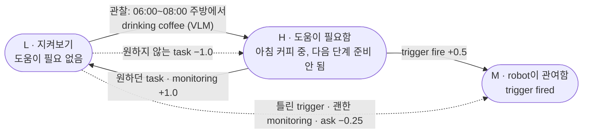
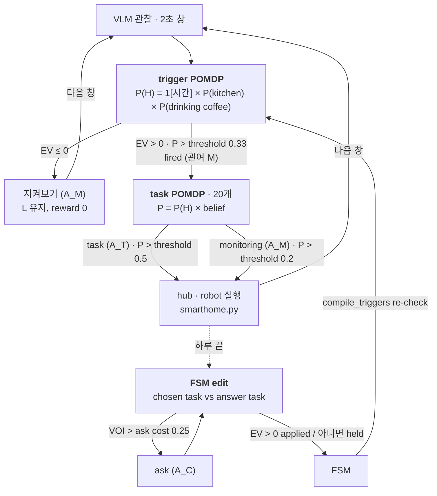

# KJH_model 

박석준의 ai 모델과 같은 방식을 쓴다(PAM: FSM 기억 + 반성으로 기억 수정). 다른 점은 POMDP를 적용한 것이다. 시각 관찰과 시간으로 **trigger가 fired인지 정하고**, FSM과 belief로 **task를 고르고**, answer task와 비교해 **FSM을 고칠지 정한다**. POMDP 설계는 Kostavelis 외, *A POMDP Design Framework for Decision Making in Assistive Robots*(HCI International 2017)의 틀을 따른다: state를 LoRA(Level of Robot Alert: High / Medium / Low)로 묶고, robot action을 세 group으로 나누고, reward를 LoRA의 변화로 정한다(4절, 그림은 [4절 그림으로 보기](#그림으로-보기)).

| | ai (PAM) | KJH_model |
|---|---|---|
| trigger 판정 | VLM이 사진 + FSM 기억을 보고 한 번에 정한다 | VLM은 관찰만 한다. 장면 사실 belief + 시간으로 코드가 정한다 |
| task 선택 | VLM이 FSM rule대로 고른다 | task 20개마다 P(원함) x P(trigger)로 EV를 계산해 고른다 |
| 기억(FSM) 수정 | 반성이 FSM을 바로 다시 씀 | proposal을 rule마다의 belief로 applied·held 정한다. 바뀌면 trigger를 re-check한다 |
| 같은 입력에 같은 답 | 보장 안 됨 | 보장(VLM 관찰 이후) |

| 시나리오 | 내용 |
|---|---|
| Coffee_man | 주방에서 커피를 마시는 영상(22초). 2026-11-03 07:00:00에 시작한다고 본다. hub(인덕션·식기세척기·냉장고)와 robot이 연결되어 있다 |

**용어:** trigger, fired(trigger가 섬), threshold(문턱), belief(믿음), EV(expected value, 기대 이득), gain·cost(이득·비용), reward, LoRA(경계 수준), group(행동 묶음), VOI(질문의 정보 가치), ask(질문), applied·held(반영·보류), add·remove, answer(정답 task), chosen(고른 task)은 코드·논문 용어 그대로 영어로 쓴다.

---

## 1. 흐름

```
mp4 ─(ffmpeg 12fps PNG, 저장 안 함)─> 2초 창 24장 ─(Qwen3.5-27B)─> 창마다 관찰 .json   ← record_video_vlm.py (VLM 호출)

하루(run_coffee.py, API 호출 없음)
  FSM ─(compile_triggers: re-check)─> trigger
  창마다: 관찰 -> trigger POMDP(사람 위치·활동 belief x 시간) -> fired이면
          task POMDP(20개 중 EV > 0) -> hub 명령 / robot 요청
  하루 끝: chosen task vs answer task -> belief 갱신 -> FSM proposal applied·held -> (바뀌면) trigger re-check
```

## 2. 폴더와 파이썬 파일

### 실행 스크립트
| 파일 | 하는 일 |
|---|---|
| `record_video_vlm.py` | mp4를 초당 12프레임 PNG로 뽑아(임시 폴더, 끝나면 지움) 2초 창마다 Qwen3.5-27B에 보내고, 창마다 관찰 기록 .json을 `data/Coffee_man/live_qwen_rep<n>/`에 저장한다(VLM 호출) |
| `run_coffee.py` | 관찰 기록으로 하루를 여러 번(`--days`) 실행한다: trigger → task → hub·robot → answer 비교 → FSM edit → trigger re-check. 결과는 `runs/coffee-<시각>/`(`report.html`: chosen task와 그 근거를 한 장에, `coffee.md`: 로그, `days.json`: 전체 값) |

### `noonchi/` (모델 본체)
| 파일 | 하는 일 |
|---|---|
| `trigger_pomdp.py` | **POMDP** 사람 위치·활동 belief와 시간으로 P(trigger) → EV로 fire를 정한다. `compile_triggers`: FSM rule과 trigger 조건을 맞춰 보고 묶는다(re-check) |
| `task_pomdp.py` | **POMDP** FSM에서 task마다 prior belief를 정하고(`task_prior`), fired이면 20개 중 EV > 0인 task를 고른다 |
| `fsm_edit.py` | **POMDP** chosen task와 answer task 비교로 belief를 고치고(`compare_with_answer`), FSM proposal을 applied·held 하거나 ask 한다 |
| `report_html.py` | 실행 결과 → `report.html`: 마지막 날 chosen task와 근거(P(trigger) × belief vs threshold, hub 응답), 날마다 trigger 표·task 후보 표·FSM edit |
| `lora.py` | LoRA reward 표 → trigger·task group·ask의 gain과 cost |
| `smarthome.py` | 가상 스마트홈 hub(등록 가전 3개, 상태 조회·명령)와 가상 robot(모든 행동 가능). task 실행과 hub 응답에 따른 다음 요청 |
| `vision.py` | VLM 호출(OpenRouter, Structured Outputs). 2초 창의 연속 프레임을 한 번에 보낸다 |
| `observation.py` | 관찰 기록 형식과 정해진 단어(사람 위치, 물체) |
| `config.py` | `config/` 읽기, `.env` 읽기 |

### 그 밖의 폴더
| 폴더 | 내용 |
|---|---|
| `config/` | 코드가 읽는 설정(3절) |
| `scenarios/Coffee_man/` | 시나리오: task 20개, FSM, trigger 조건, hub |
| `data/Coffee_man/` | 영상(`Coffee_man.mp4`), answer task(`answer.json`), 관찰 기록 `live_qwen_rep1/`(2026-11-04 Qwen3.5-27B, 11창) |
| `runs/` | 실행 결과(자동 생성, Git 제외) |

## 3. JSON 파일

| 파일 | 내용 | 읽는 코드 |
|---|---|---|
| `config/model.json` | VLM 관찰 역할, 영상 설정(초당 12프레임, 2초 창, 가로 640px), VLM 확신별 정확도 | 전체 |
| `config/openrouter.json` | VLM Qwen3.5-27B. ai 저장소와 같은 설정이다 | `vision.py` |
| `config/sensor.json` | VLM 관찰 모델: 검출률 0.85, 오검출 0.05, 자리 혼동(주방↔식사 공간), 활동 분류 정확도 0.8, 창 사이 유지 확률 | `trigger_pomdp.py` |
| `config/lora.json` | LoRA H/M/L, LoRA 변화의 reward 표, group(task / communication / monitoring)마다 원할 때·원하지 않을 때 가는 LoRA | `lora.py` |
| `config/fsm_edit.json` | prior belief(FSM rule 0.8, 새 proposal 0.5, 관계없는 task 0.05), 반응 확률, 하루 ask 수 | `fsm_edit.py`, `task_pomdp.py` |
| `scenarios/Coffee_man/scenario.json` | 영상 경로, 시작 시각(2026-11-03T07:00:00), 각 파일 이름, task 20개의 한국어 설명 | 두 스크립트 |
| `scenarios/Coffee_man/tasks.json` | task 문장 20개(PAM 형식). FSM rule의 action은 이 문장과 똑같아야 한다 | `run_coffee.py` |
| `scenarios/Coffee_man/task_specs.json` | task마다 실행 경로(hub/robot), 돕는 FSM state(serves), group, 전제 조건(requires), hub 응답에 따른 다음 요청(then) | `task_pomdp.py`, `smarthome.py` |
| `scenarios/Coffee_man/initial_fsm.json` | 초기 FSM: 커피 → 컵 세척 → 냉장고 확인 → 요리(transition p 0.9). 커피 state에 rule 3개 | `run_coffee.py` |
| `scenarios/Coffee_man/triggers.json` | FSM trigger 문장을 조건으로 옮긴 것: 시각 06:00~08:00 + 사람 위치 주방 + 활동 "drinking coffee". 활동 분류 단어 | `trigger_pomdp.py` |
| `scenarios/Coffee_man/hub.json` | hub 등록 가전 3개의 명령과 처음 상태, 처음 상태 두 가지(식기세척기 가동 중 / 가동 종료) | `smarthome.py` |
| `scenarios/Coffee_man/provenance.json` | 초기 기억과 task를 정한 근거 | 사람이 읽음 |
| `data/Coffee_man/answer.json` | answer task [0, 1, 2]. 모델 입력이 아니며 하루가 끝난 뒤 비교에만 쓴다 | `run_coffee.py` |
| `data/Coffee_man/live_qwen_rep1/` | 창마다 관찰 기록(`frames/070000.json` ~ `070020.json`)과 기록 정보 | `run_coffee.py` |

관찰 기록(VLM schema, `noonchi/vision.py`): `summary`, `people`(`location`, `activity`), `time`, `objects`. 가전 상태는 관찰에 넣지 않고 hub로만 안다. `time`은 코드가 알려 준 시각을 VLM이 그대로 적고, 저장할 때도 코드가 정한 시각(시작 + 창 위치)을 쓴다.

## 4. POMDP 설계 (Kostavelis 외, 2017)

**근거 논문:** I. Kostavelis, D. Giakoumis, S. Malassiotis, D. Tzovaras, *A POMDP Design Framework for Decision Making in Assistive Robots*, HCI International 2017, LNCS 10271, pp. 467–479. 도우미 로봇의 판단을 POMDP로 설계하는 방법을 제안한 논문이다. 같은 저자들이 이 설계로 복약 보조 로봇을 만들었다(Kostavelis 외, *Robotic Assistance in Medication Intake: A Complete Pipeline*, Applied Sciences 2022). 논문의 예시 시나리오도 요리하는 노인을 돕는 로봇이다: 빠진 재료를 가져올지 묻고, 냉장고·찬장 상태를 살피고, 켜 두고 잊은 가전을 끈다.

### 그림으로 보기

**① LoRA와 reward** — 논문 Fig. 1의 생각: 관찰은 LoRA를 올리고, robot action은 내린다. 실선은 상황이 맞을 때, 점선은 틀렸을 때다.



**② 한 창과 하루의 판단 흐름** — 세 POMDP(4-1 trigger, 4-2 task, 4-3 FSM edit)가 어디서 무엇을 정하는지, group(A_T / A_C / A_M)이 어디서 쓰이는지 보인다.



### 논문 설계와 이 모델의 대응

| 논문의 설계 | 이 모델에서 |
|---|---|
| POMDP = {S, A, Ω, R, O, T, b0}. S는 사람·환경의 state, A는 robot action만 | 세 부분(4-1~4-3) 모두 이 튜플로 적었다(아래 표, 코드 주석) |
| state를 LoRA(Level of Robot Alert)로 묶는다: **H** 도움이 필요함, **M** robot이 이미 관여함, **L** 도움이 필요 없음(지켜보기만). 하루는 L에서 시작해 L로 끝난다 | H = 아침 커피를 마시는 중이고 다음 단계(컵 세척·냉장고 확인·요리) 준비가 안 됨. L = 그 밖. trigger가 fired이면 M |
| robot action을 세 group으로 나눈다: **A_T** task(이동·조작처럼 환경을 바꿈), **A_C** communication(대화·알림), **A_M** monitoring(사람·물체·가전 상태 인식) | task 20개 중 17개는 task group(hub로 가전 켜기·끄기·설정, robot이 물건을 옮기거나 문을 엶), 3개(1 냉장고 촬영, 2 식기세척기 확인, 7 식기세척기 촬영)는 monitoring. FSM edit 전 ask가 communication. VLM으로 다음 창을 보는 것이 기본 monitoring |
| reward: action이 LoRA를 **낮추면 양수, 높이면 음수**, M→M은 고르게 | `config/lora.json`의 reward 표 하나에서 trigger·task·ask의 gain과 cost가 모두 나온다(아래 표) |
| 관찰은 LoRA를 올리고, action은 내린다 | VLM이 drinking coffee를 보면 L → H(trigger), task를 하면 H → L |
| 상태도를 지도로 써서, 이어진 state 사이의 transition 확률을 높게 준다(T) | FSM의 transition(p 0.9)으로 다음 state까지 갈 확률(reach)을 곱해, 그 state를 돕는 task의 prior belief를 정한다(4-2) |
| POMDP는 무엇을 할지만 정하고, 낮은 수준의 실행은 아래 계획기가 맡는다 | task 실행과 hub 응답에 따른 다음 요청(식기세척기 남은 시간 / 내부 사진)은 `smarthome.py`가 맡는다 |
| solver는 논문의 범위 밖이다. 어떤 solver든 쓸 수 있다고 본다 | 한 단계 앞만 보는 EV `P·gain − (1−P)·cost > 0`으로 고른다 |

**reward 표** (`config/lora.json`, 행 → 열. 크기는 논문에 없어 사람이 정했다)

| from \ to | H | M | L |
|---|---|---|---|
| H | 0 | +0.5 | +1.0 |
| M | −0.5 | 0 | +0.5 |
| L | −1.0 | −0.25 | 0 |

| action | 원할 때(H에서) | 원하지 않을 때(L에서) | gain / cost | threshold P |
|---|---|---|---|---|
| trigger fire(관여) | H → M (+0.5) | L → M (−0.25) | 0.5 / 0.25 | 0.33 |
| task(A_T) | H → L (+1.0) | L → H (−1.0): 거주자가 되돌려야 함 | 1.0 / 1.0 | 0.5 |
| monitoring(A_M) | H → L (+1.0) | L → M (−0.25): robot이 괜히 관여함 | 1.0 / 0.25 | 0.2 |
| ask(A_C) | — | L → M (−0.25) | ask cost 0.25 | — |

threshold P = cost / (gain + cost). 환경을 바꾸는 task는 틀리면 cost가 커서 더 확실할 때만 하고, 상태만 알아내는 monitoring은 덜 확실해도 한다. 예전에는 task 종류 7가지마다 gain·cost를 따로 정했지만(확인 0.3/0.05, 끄기 0.2/1.0 등) 근거가 없어 이 표로 바꿨다.

### 4-1. trigger fire (`trigger_pomdp.py`)
| 요소 | 내용 |
|---|---|
| S | 사람 위치, 사람 활동(drinking coffee / other). 조건을 모두 만족하면 H, 아니면 L |
| 시간 | 숨은 state가 아니다. 시작 시각 + 창 위치로 정해지므로 06:00~08:00이면 1, 아니면 0 |
| A | 지켜보기(monitoring, reward 0) / trigger fire(관여) |
| Ω, O | VLM의 `people.location`, `people.activity`(단어 묶음으로 분류: [drink, sip] + [coffee, mug, cup]). 검출률·오검출·자리 혼동·활동 분류 정확도(`config/sensor.json`) |
| T, b0 | 창마다 유지 확률(`stay`)로 값을 유지한다. 처음에는 고르게 |
| P(trigger) | P(trigger) = P(H) = 1[시간] × P(kitchen) × P(drinking coffee) |
| fire | `P·0.5 − (1−P)·0.25 > 0`(threshold P > 0.33) |
| re-check | FSM이 바뀔 때마다 rule의 trigger 문장마다 조건이 있는지, state가 같은지, 문장의 시간 범위가 조건과 같은지 확인한다. 통과하지 못한 rule은 trigger로 세우지 않고 이유를 남긴다 |

### 4-2. task 선택 (`task_pomdp.py`)
| 요소 | 내용 |
|---|---|
| S | task마다 "거주자가 이 상황에서 원한다(H) / 원하지 않는다(L)" |
| A | task 20개(task group 17개, monitoring 3개). 고르지 않으면 지켜보기 |
| Ω | P(trigger), hub가 알려 주는 기기 상태 |
| T, b0(FSM에서) | FSM rule인 task 0.8. FSM의 다음 state를 돕는 task는 0.5 × reach(그 state까지 갈 확률: 컵 세척 0.9, 냉장고 확인 0.81, 요리 0.73). 그 밖 0.05 |
| 전제 조건(requires) | hub가 알려 주는 상태(예: 인덕션이 꺼져 있어야 켠다). 맞지 않으면 blocked |
| R, 결정 | P(task) = P(trigger) × belief, `P·gain − (1−P)·cost > 0`이면 요청(하루 한 번). gain·cost는 group별(위 표) |

### 4-3. FSM edit (`fsm_edit.py`)
하루가 끝나면 chosen task와 answer task를 비교한다. chosen + answer에 있음 = accepted, chosen + answer에 없음 = rejected, 안 골랐지만 answer에 있음 = self-done(거주자가 직접 함). 증거의 무게는 그때의 P(trigger)다. proposal(answer에 있는데 FSM에 없으면 add, answer에 없는데 FSM에 있으면 remove)은 바로 반영하지 않는다. 같은 gain·cost로 EV를 계산해 applied·held를 정하고, VOI가 ask cost(communication, 0.25)보다 크면 먼저 ask 한다(하루 1개). FSM이 바뀌면 trigger를 re-check한다(4-1). 거주자의 선호를 날마다 배우는 이 부분은 논문에 없고, 4-2와 같은 belief·reward를 쓴 것이다.

## 5. 결과 (Qwen3.5-27B 관찰, `live_qwen_rep1`)

영상 22초를 2초 창 11개로 나눴다(Qwen 호출 11회, 74,580토큰, 2026-11-04). VLM은 07:00:04부터 "drinking from a cup"을 보고했고, 사이사이 "holding a cup"(마시지 않음)도 보고했다.

| 시각 | 07:00:00 | :02 | :04 | :06 | :08 | :10 | :12 | :14 | :16 | :18 | :20 |
|---|---|---|---|---|---|---|---|---|---|---|---|
| VLM 활동 | 상자 정리 | 컵 젓기 | 마심 | 마심 | 듦 | 듦 | 듦 | 듦·마심 | 마심 | 마심 | 물건 듦 |
| P(trigger) | 0.16 | 0.09 | 0.51 | 0.79 | 0.38 | 0.15 | 0.08 | 0.50 | 0.78 | 0.88 | 0.47 |
| trigger POMDP | | | fired | fired | fired | | | fired | fired | fired | fired |
| one-frame baseline | | | fired | fired | | | | fired | fired | fired | |

one-frame baseline: belief 없이 그 창의 VLM 보고만 믿고 조건을 맞춘 것.

같은 영상을 3일 반복(`python run_coffee.py`). answer는 {0 인덕션 켜기, 1 냉장고 촬영, 2 식기세척기 확인}이다.

| day | chosen | right | extra | missed | FSM rules after |
|---|---|---|---|---|---|
| 1 | 0, 1, 2, 7, 8, 12 | 0, 1, 2 | 7 식기세척기 촬영, 8 냉장고 문 열기, 12 컵 넣기 | 없음 | 0, 1, 2, 12 |
| 2 | 0, 1, 2, 7 | 0, 1, 2 | 7 | 없음 | 0, 1, 2 |
| 3 | 0, 1, 2 | 0, 1, 2 | 없음 | 없음 | 0, 1, 2 |

- **1일:** 초기 FSM의 rule 8·12는 습관 문장을 글자 그대로 옮긴 것이라 answer가 아니었다. 1·2는 FSM에 없었지만 FSM의 다음 state(냉장고 확인·컵 세척)를 돕고, monitoring이라 틀려도 cost가 작아(threshold 0.2) 처음부터 골랐다.
- **group에 따른 순서:** monitoring(1·2·7)은 P(trigger)가 0.51이던 07:00:04에 골랐고, 환경을 바꾸는 task(0·8·12)는 더 확실해진 07:00:06(P 0.79)에 골랐다. 논문처럼 덜 끼어드는 action을 먼저, 끼어드는 action은 확실할 때 한다.
- **FSM edit:** 1일 밤에 1·2를 add 하고, ask로 확인한 8을 remove 했다. 12는 증거가 아직 약해(belief 0.55) held 했고, 2일 밤에 ask로 확인해 remove 했다. 7(monitoring)은 threshold가 낮아 2일에도 한 번 더 골랐고, rejected가 두 번 쌓인 3일에는 고르지 않았다. FSM이 바뀔 때마다 trigger를 re-check했고 문제는 없었다.
- **예전 값과 비교:** task 종류 7가지별 gain·cost를 쓰던 때는 2일에 0, 1, 2, 12를 골랐다. LoRA reward 표로 바꾼 뒤 2일 결과만 달라졌고, 3일째 answer와 같아지는 것은 같다. reward 표 값은 answer에 맞추려고 고치지 않았다.
- **식기세척기 확인(task 2):** hub 상태가 가동 중이면 남은 시간(25분)을 조회했다. `--hub dishwasher_finished`로 가동 종료 상태에서 시작하면 robot에게 내부 사진을 요청했다. 두 경우 모두 3일째 answer와 같았다.
- **re-check 확인:** FSM의 한 rule 문장에서 시간을 08:00 → 09:00으로 바꾸면 그 rule은 trigger에서 빠졌다. 이유는 "no condition in triggers.json for this trigger text"였다. 모든 rule을 빼면 trigger가 세워지지 않았다(unused).

## 6. 실행

Python 3.10 이상이 필요하고, 외부 패키지는 없다. `run_coffee.py`는 API 키 없이 돌아간다. `record_video_vlm.py`만 VLM(Qwen3.5-27B, OpenRouter)을 호출하며, ffmpeg가 필요하다(환경 변수 `FFMPEG`, PATH, 또는 `~/.local/share/imageio-ffmpeg/ffmpeg`). 키 `OPENROUTER_API_KEY`는 `.env`에만 넣는다.

```bash
python run_coffee.py
```

터미널에는 날마다 한 줄 요약과 결과만 나온다. 창마다 자세한 로그는 `-v`를 붙인다(로그는 항상 `runs/coffee-<시각>/coffee.md`에 저장된다).

```bash
python run_coffee.py -v
```

```bash
python run_coffee.py --hub dishwasher_finished
```

```bash
python record_video_vlm.py --rep 2
```

## 7. 한계

- 모든 POMDP는 한 단계만 본다(논문은 solver를 정하지 않았다). 변수끼리는 독립으로 근사했다. 수치(reward 표·transition p·prior belief)는 사람이 정했다. 논문은 reward의 부호 규칙만 주고 크기는 주지 않는다.
- 같은 group의 task는 cost가 같다. 냉장고 끄기처럼 위험한 task도 컵 넣기와 같은 L→H로 본다.
- 영상이 하나뿐이라 "여러 날"은 같은 관찰을 반복한 것이다. answer task도 한 가지라, FSM이 answer로 수렴하는지만 확인했다.
- belief는 task마다 하나다(trigger가 여러 개가 되면 trigger x task로 나눠야 한다).
- trigger 문장을 사람이 조건으로 옮겨야 한다. 문장이 바뀌면 re-check가 그 rule을 막을 뿐, 조건을 새로 만들지는 않는다.
- 가전 상태는 VLM 관찰에 없고 hub로만 안다. hub에 등록되지 않은 가전은 알 수 없다. (`live_qwen_rep1`은 schema에서 `electronics`를 빼기 전에 기록해 그 항목이 남아 있지만, 읽을 때 쓰지 않는다.)
- "holding a cup"(마시는 중간에 든 상태)은 drinking coffee로 세지 않는다. 그래서 07:00:10~12에는 P(trigger)가 내려갔다.
- hub·robot은 가상이다. 실제 기기 동작과 사진은 없다.
