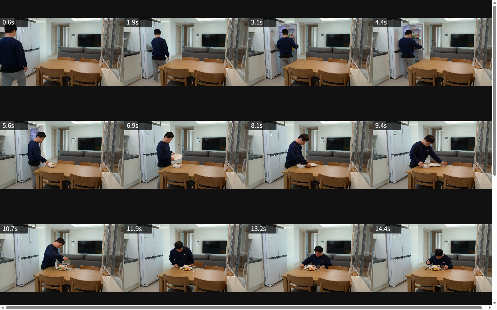
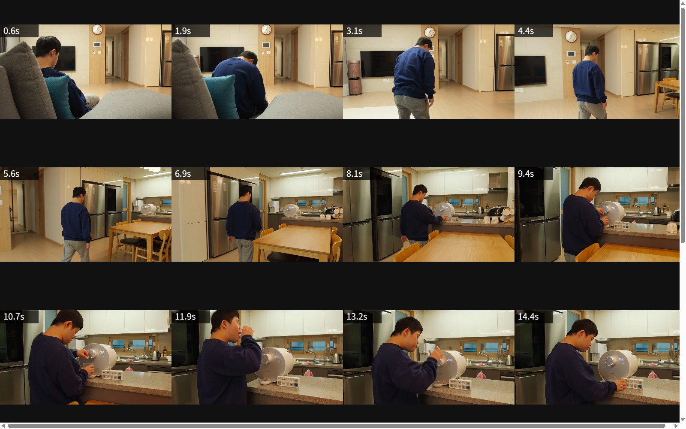

# 코치모드 영상 시험 보고서

2026-11-22 · 발달장애인 코치모드(`NOONCHI_PROFILE=care`) · OpenAI 추론(`INFERENCE_MODE=openai`)

## 1. 요약

실제 촬영 영상 9개(가전 시나리오 6개, 약 먹기 습관 3개)를 폰 영상 모드로 서버에 넣고, 영상 분석(VLM)과 판단(PAM)을 OpenAI `gpt-5.4-mini`로 돌렸다.

| 시나리오 | 결과 | 한 줄 |
|---|---|---|
| 가전 1. 냉장고 문 열림 → 바로 컵·접시 준비 | **성공** | 문 열림 0.3초 뒤 PAM 없이 「컵과 접시 준비하기」, 폰 명령 6단계를 끝까지 수행 |
| 습관 2. 필수 습관은 묻지 않고 실행 | **성공(기록은 손으로 넣음)** | OpenAI가 약 먹기를 「필수」로 판단, 묻지 않고 「약과 물 가져다주기」 계획·명령 |
| 습관 1. 영상에서 약 먹기를 기록 | **부분** | 약 영상 9번 실행 중 1번만 VLM이 「약 먹는 중」으로 읽음. 나머지는 「먹거나 마시는 중」 등 |
| 가전 2. 식사 중 자리 비움 → 따라가 관찰 | **실패** | PAM 답이 계약에 맞지 않아 버려짐(3.3) |
| 가전 3. 음식을 남기고 TV → 남은 음식 전달 | **해당 없음** | 영상에서는 사용자가 음식을 직접 들고 감. PAM은 「대기」(맞는 판단) |
| 가전 4·5. 다 먹고 TV → 정리 | **실패** | 식사 끝을 알아채지 못해 PAM이 「대기」 |
| 가전 6. 계획 뒤 사용자 곁에서 관찰 | **확인 못 함** | 계획이 끝난 뒤 사용자 곁으로 가는 명령이 나오지 않음 |

시험 중에 코드 결함 4개를 찾아 고쳤다(5장). 고치기 전에는 서버가 `.env`의 코치모드 설정을 아예 읽지 못하고 있었다.

## 2. 시험 방법

### 2.1 환경

| 항목 | 값 |
|---|---|
| 서버 | `npm start`와 같은 `src/server/main.ts`, 포트 9200(폰 9210). 이 PC는 Windows가 8035~8534 포트를 막아 기본 포트(8200·8210)를 못 씀 |
| 집 | `apartment`(마곡 보타닉 아파트, 방 13개·기기 65개), 허브 Matter |
| 영상 분석 | YOLO(로컬) + VLM `gpt-5.4-mini`(2초마다 최근 5장) |
| 판단 | PAM `gpt-5.4-mini`, 코치모드 seed FSM 기억(`CARE_FSM_MEMORY`) |
| 사용자 정보 | `CARE_USER_INFO=저녁 식후 약을 꼭 먹어야함` |
| 습관 중요도 모델 | OpenAI `gpt-5.4-mini`(시험에서만 `CARE_LLM_URL`로 지정. 실제 배포는 Qwen 생각 모델) |
| 밤 반성 | 시험 동안 끔(`REFLECT_AT=off`) |

### 2.2 돌린 방법

- `scripts/video-check.ts`가 헤드리스 크롬으로 폰 페이지(`/phone/?clip=…`)를 열고 영상을 실제 폰처럼 서버로 보낸다. 폰 명령이 오면 3초 뒤 「완료」 단추를 눌러 사용자가 따른 것으로 본다.
- 이어진 영상(가전 1~6)은 **한 서버에서 차례로** 돌려 사람 상태와 World State를 이었다(`--continue`, 이번에 새로 넣음).
- 영상만으로는 냉장고 문 신호가 없으므로, 영상에서 냉장고를 여는 3초에 트윈 냉장고 문을 열었다(`--twin 3:fridge_1:door=open`, 이번에 새로 넣음). 실제 집에서는 ThinQ 냉장고가 이 신호를 보낸다.
- 한 묶음 실행: `bash scripts/care-video-run.sh <묶음> <영상…>`(새 서버를 띄우고 영상을 돌린 뒤 서버를 끈다).

### 2.3 영상

영상은 모두 15초다. 장면마다 고르게 12장을 뽑은 사진은 `frames/`에 있다.

| 영상 | 내용 |
|---|---|
| `appliance_part1` | 냉장고를 열고 음식을 꺼내 식탁에 차리고 먹기 시작 |
| `appliance_part2` | 식탁에서 먹다가 음식을 둔 채 자리를 뜸 |
| `appliance_part3` | 음식을 거실 탁자로 옮기고 소파에 앉아 TV를 켬 |
| `appliance_part4` | TV를 보며 거실에서 먹음 |
| `appliance_part5` | 다 먹고 TV를 끔. 끝 무렵 그릇이 치워짐 |
| `appliance_part6` | 소파에 앉아 쉼 |
| `medicine_day1`, `medicine_day2`, `medicine_day2_linked` | 소파·거실에서 일어나 주방으로 가서 약통의 약을 물과 함께 먹음(세 영상 모두 약을 먹음) |

## 3. 시나리오별 결과

### 3.1 가전 1 — 냉장고 문 열림(성공)

`timelines/appliance_part1.20261122-231453.timeline.md`, `appliance_part2.20261122-231554.timeline.md`

| 영상 시각 | 일 |
|---|---|
| 00:03.4 | 냉장고 문 열림 신호 |
| 00:03.7 | **판단 「컵과 접시 준비하기」** (PAM을 부르지 않은 코치모드 규칙, 까닭 `fridge_open`) |
| 00:17~00:38 | 계획 모드 3차례(앞 2차례는 계획 검사에서 버려짐) 뒤 계획 통과 |
| 00:38.0~ | 폰 명령: 냉장고로 → 상부장으로 → 그릇 꺼내기 → 컵 꺼내기 → 식탁으로 → 그릇·컵 놓기 |
| 다음 영상 00:35.6 | 「컵과 접시 준비하기」 끝남, 「컵과 접시 준비하기를 마쳤어요.」 |

- 시나리오대로 관찰 과정을 건너뛰고 바로 행동을 골랐다. 문이 열린 뒤 판단까지 0.3초였다.
- 같은 묶음의 앞선 실행(23:10)에서도 같은 판단이 3.3초에 나왔고, 계획은 한 번에 통과해 6단계를 끝까지 마쳤다.
- **느린 곳**: 계획 모드가 같은 이유(「집기 until은 집는 물건 종류만 봅니다」)로 두 번 버려져 첫 명령이 34초 늦어졌다. 약과 물 가져다주기 계획에서도 같은 일이 있었다.
- 시나리오의 첫 명령 글은 「주방 입구로 이동해주세요」인데, 실제 첫 명령은 계획이 정한 「냉장고로 가 주세요」(앞 실행은 「상부장 80로 가 주세요」)였다. 첫 명령 글은 계획 모델이 정한다.

### 3.2 습관 — 기록·반성·필수 습관 실행

습관은 서로 다른 날 2일 이상 같은 시각 근처에 보여야 생긴다. 시험은 하루(같은 날)에 했기 때문에 날을 이렇게 나눴다.

1. `medicine_day1`을 돌리고 그날 기록을 11-20로 옮긴다.
2. `medicine_day2`를 돌리고 그날 기록을 11-21로 옮긴다.
3. 반성(습관·중요도) 뒤 `medicine_day2_linked`를 「오늘」로 돌린다.

**기록(부분 성공)** — VLM이 약 먹는 장면을 「약 먹는 중」(`taking_medicine`)으로 읽은 것은 약 영상 9번 실행(설정을 고치며 다시 돌린 것 포함) 가운데 한 번(00:15.8)뿐이다. 그 한 번은 아래 5.3의 결함으로 기록되지 못했다. 나머지는 「먹거나 마시는 중」이었다. 약 먹는 장면은 영상 끝 3~4초에 있고 VLM은 2초마다 보므로 볼 수 있는 장면이 적다. 영상을 반 빠르기로 틀어도(`--rate 0.5`), 어휘 설명(hint)을 넣어도 결과는 같았다. 그래서 1·2일차는 습관 기록이 0개다.

**반성과 필수 판단(성공)** — 습관 경로를 시험하려고 「11-20, 11-21 22:50 약 먹기」 두 기록을 손으로 넣고(`scripts/care-reflect.ts add`) 반성을 돌렸다. 결과(`care-habits.day3.json`):

| 습관 | 평소 시각 | 날 수 | 식사 | 중요도 | 판단 |
|---|---|---|---|---|---|
| 약 먹기 | 22:50 | 2일 | 식사와 무관 | **필수** | OpenAI `gpt-5.4-mini`(규칙으로 대신하지 않음) |

**필수 습관 실행(성공)** — `medicine_day2_linked`(23:00, 평소 시각 22:50 뒤, 오늘 약을 아직 안 먹음):

- 서버가 뜨자마자 코치모드 규칙이 **사용자에게 묻지 않고** 「약과 물 가져다주기」를 골랐다(까닭 `habit_essential`, PAM 호출 없음).
- 계획 모드 3차례 뒤 계획 통과, 폰 명령 「상부장 80로 가 주세요」 → 「컵을 꺼내 주세요」 → 싱크대로 …
- 영상이 끝나 계획은 마치지 못했다(판정: 계획 안 끝남).
- 판단은 폰이 붙기 전에 나와 시각표에는 계획부터 보인다. 습관 시각이 지나 있으면 첫 판단 타이머에서 바로 나온다.

### 3.3 가전 2 — 식사 중 자리 비움(실패)

`appliance_part2`: 사용자가 음식을 두고 식탁을 떠난 뒤(00:18.6 사람 안 보임) PAM은 「식사 도중 다른 방 → 사용자 곁에서 지켜보기」 화살표를 고르려 했다. 하지만 답이 계약에 맞지 않아 버려졌다.

- 첫 실행: `transition drinking[2] goes to 'drinking'`. 화살표는 「식사 중 유지」인데 상태를 다르게 적어 옴. **고침**(5.4).
- 고친 뒤 실행: `prediction.from: expected null or the previous state 'away'`. 직전 판단 상태가 이미 `away`로 바뀌어 있어 「식사 중에서 나가는」 화살표를 고를 수 없었다. 고치지 않음(6장).

### 3.4 가전 3·4 — TV 앞 식사(해당 없음, 올바른 대기)

시나리오 3은 「음식을 식탁에 남기고 TV」인데, 영상에서는 사용자가 음식을 직접 거실 탁자로 옮겼다. VLM은 「TV 보는 중」, 「먹거나 마시는 중」으로 읽었고 PAM은 「대기」였다. 가져다줄 남은 음식이 식탁에 없으므로 대기가 맞는 판단이다. 시나리오 3을 시험하려면 음식을 식탁에 두고 소파로 가는 영상이 필요하다.

### 3.5 가전 4·5 — 다 먹고 정리(실패)

`appliance_part5`에서 사용자는 다 먹고 TV를 끈다. 하지만 PAM은 「대기」만 냈고 「컵 치우기」는 나오지 않았다. 영상 끝 무렵 그릇이 사라진 것(사람이 치움)은 물건 사라짐으로 기록됐다. 사람 상태가 앞 영상에서 이미 `away`로 넘어가 「식사 중 → 다 먹고 TV」 화살표가 걸릴 자리가 없었다(3.3과 같은 원인).

### 3.6 가전 6 — 사용자 곁 관찰(확인 못 함)

가전 1의 계획이 끝난 뒤 「사용자 곁으로 가 주세요」 명령이 나오지 않았다. 코치모드는 사용자의 바닥 위치(`person.position`)를 목표로 삼는데, 이 시험의 폰은 위치 맞추기를 하지 않아 그 값이 없었을 것으로 보인다. 이 집에는 충전 자리 파일도 없어 대신 갈 곳도 없다. 원인은 확인하지 않았다.

## 4. 판단(PAM) 관찰

| 관찰 | 횟수·예 | 영향 |
|---|---|---|
| 기억에 없는 임시 상태로 답함 | `~standing`(여러 번), `~using_drink_machine`, `~other` | 그 판단을 버림(행동 없음). `~`는 활동 어휘에 있는 임시 상태만 받는데 `standing`은 자세라 어휘 밖 |
| 머무는 화살표인데 상태를 다르게 적음 | `drinking[2] goes to 'drinking'` | 고침(5.4) |
| 직전 상태 이야기와 어긋남 | `expected null or the previous state 'away'` | 사람 상태가 식사 중을 지키지 못함(6장) |
| 대부분의 판단 | 「대기」 | 행동하지 않음 |

VLM이 사람 활동을 잘못 읽은 예: 냉장고에서 음식을 꺼내 식탁에 차리는 장면을 「노트북 쓰는 중」(세 번)·「정리하는 중」으로, 주방에서 약을 먹는 장면을 「휴대폰 쓰는 중」(세 번)으로 읽었다.

## 5. 시험 중 고친 결함

| # | 결함 | 증상 | 고친 곳 |
|---|---|---|---|
| 5.1 | `.env`를 모든 모듈보다 늦게 읽음 | 서버가 `NOONCHI_PROFILE=care`를 못 봐서 코치모드가 꺼진 채로 돌았음(행동 목록·seed 기억이 눈치모드) | `src/server/env-first.ts`(첫 import에서 `.env`를 읽음), `src/server/main.ts` |
| 5.2 | 버스 판단 메시지 모양에 `care` 칸이 없음 | 코치모드 판단이 「Unrecognized key: care」로 버려져 폰 명령이 나가지 않음 | `src/bus/topics.ts`, `src/contract/events.ts`, 시험 `tests/care-coach.test.ts` |
| 5.3 | 행동 중에는 습관 기록을 하지 않음 | 다른 목표를 실행하는 동안 본 약 먹기를 놓침 | `src/brain/decide.ts`(기록은 언제나, 규칙 행동만 행동 중이 아닐 때) |
| 5.4 | 머무는 화살표를 고르면서 상태를 다르게 적은 답을 버림 | 식사 중 자리 비움 판단이 버려짐 | `src/brain/decision.ts`(코치모드에서만 상태를 화살표대로 지킴) |

그 밖에 `src/world/vocab.ts`의 「약 먹는 중」에 VLM 설명(약통·물)을 더했다. 다만 이번 시험에서 효과는 보이지 않았다.

시험용으로 더한 것은 다음과 같다.

- `scripts/video-check.ts`: `--continue`, `--twin`, 코치모드 기억 검사
- `scripts/care-video-run.sh`: 한 서버 묶음 실행
- `scripts/care-reflect.ts`: 습관 기록 보기·옮기기·넣기·반성
- `scripts/clip-contact.ts`: 영상 12장 사진
- `scripts/md-to-pdf.ts`: 이 보고서 PDF

복사해 온 원본 기록 DB는 `runtime/backup-noonchi-db/`로 옮겨 두었다. 눈치모드 기억이 코치모드 시험에 섞이지 않게 하려는 것이다.

## 6. 남은 문제와 제안

1. **식사 중 상태를 지키기(가전 2·4·5)**: 사람이 안 보이면 PAM이 상태를 바로 `away`로 바꾼다. 그 뒤로는 식사 중 화살표가 걸리지 않는다. 코치모드 `holdState`는 화살표 없는 바뀜만 막는다. 음식이 남아 있으면 `away`로의 바뀜도 식사 중으로 지키거나, `away`에서 「남긴 채 TV」·「다 먹고 TV」 화살표를 더하는 방법을 제안한다.
2. **약 먹기 인식(습관 1)**: VLM이 약 먹는 장면을 마시기로 읽는다. 약통을 YOLO·VLM 물건 어휘에 더하거나, 습관 기록에서 「약통 근처에서 마시는 중」도 약 먹기로 보는 규칙을 검토한다. 영상도 약 먹는 장면을 조금 더 길게 찍으면 좋다.
3. **계획 모드 재시도**: 「집기 until은 집는 물건 종류만 봅니다」로 계획이 두 번씩 버려져 첫 명령이 30초 넘게 늦다. 코치모드 행동 4개의 계획 예시를 손보면 줄일 수 있다.
4. **임시 상태 `~standing`**: PAM 지시문에 「자세(standing)는 상태가 아니다」를 더하거나, 코치모드 FSM에 「서서 움직이는 중」 상태를 두는 방법이 있다.
5. **시나리오 3 영상**: 음식을 식탁에 남기고 소파로 가는 장면을 따로 찍어야 시험할 수 있다.
6. **사용자 곁 관찰(가전 6)**: 폰 위치 맞추기를 한 영상이나 실제 폰으로 다시 확인해야 한다.

## 7. 비용과 기록

- VLM(`gpt-5.4-mini`)은 시험 전체에서 대략 $1.3이 들었다(디버깅 재실행 포함, 서버가 센 값의 합). PAM·계획·습관 판단 호출 비용은 세지 않았다.
- 시각표 원본: `timelines/`(각 영상의 최종 실행, 대시보드 사진 포함)
- 서버·시험 기록: `runtime/test-logs/`
- 영상 사진: `frames/`
