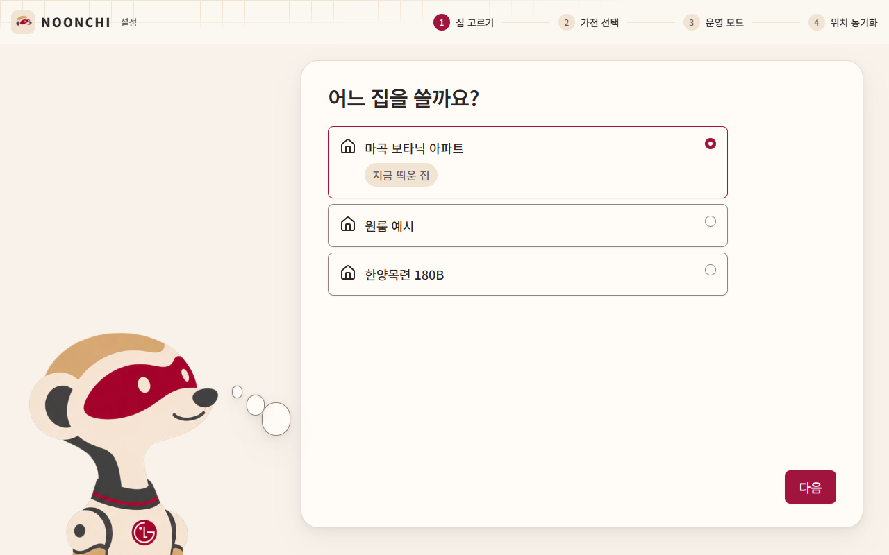

# 영상 판정 · medicine_day2.mp4

2026-11-22 22:55:17 · 실제 서버 http://127.0.0.1:9200

코치모드 기억 1판 · seed

| 영상 시각 | 종류 | 글 |
|---|---|---|
| 00:00.1 | 사람 | 자리에 없음 |
| 00:00.6 | PAM 판단 | 대기 ×4 |
| 00:01.2 | 사람 등장 | 사람 보임 |
| 00:02.7 | 사람 | TV 보는 중 |
| 00:05.3 | 사람 | 쉬거나 잘 준비하는 중 |
| 00:06.9 | 사람 | 걷는 중 |
| 00:07.8 | 사람 | 먹거나 마시는 중 |
| 00:10.3 | 물건 등장 | 컵 cup_1 보임 |
| 00:10.3 | 물건 등장 | 컵 cup_2 보임 |
| 00:10.3 | 물건 등장 | 컵 cup_3 보임 |
| 00:10.3 | 물건 등장 | 컵 cup_4 보임 |
| 00:10.7 | 트윈 | 컵 cup_1 자리 모름 · 놓인 곳 모름 |
| 00:10.7 | 트윈 | 컵 cup_2 자리 모름 · 놓인 곳 모름 |
| 00:10.7 | 트윈 | 컵 cup_3 자리 모름 · 놓인 곳 모름 |
| 00:10.7 | 트윈 | 컵 cup_4 자리 모름 · 놓인 곳 모름 |
| 00:10.9 | PAM 판단 | 판단 실패: PAM 답이 계약에 맞지 않음(대기와 다름): prediction.state: unknown state identifier '~standing' |
| 00:12.6 | 사람 | 휴대폰 쓰는 중 |
| 00:12.6 | 물건 등장 | 컵 cup_5 보임 |
| 00:12.6 | 물건 등장 | 컵 cup_6 보임 |
| 00:12.6 | 물건 등장 | 컵 cup_7 보임 |
| 00:12.6 | 트윈 | 컵 cup_5 자리 모름 · 놓인 곳 모름 |
| 00:12.6 | 트윈 | 컵 cup_6 자리 모름 · 놓인 곳 모름 |
| 00:12.6 | 트윈 | 컵 cup_7 자리 모름 · 놓인 곳 모름 |
| 00:13.4 | 사람 | 먹거나 마시는 중 |
| 00:13.4 | 목표 | 세움 · 컵 치우기 |
| 00:13.4 | 관리 | 목표 실행 |
| 00:13.6 | 트윈 | 컵 cup_1 자리 모름 · 선반 위 |
| 00:13.6 | 트윈 | 컵 cup_2 자리 모름 · 선반 위 |
| 00:13.6 | PAM 판단 | 대기 ×7 |
| 00:14.6 | 트윈 | 컵 cup_3 자리 모름 · 조리대 위 |
| 00:15.0 | 물건 사라짐 | 컵 cup_4 사라짐 |
| 00:15.0 | 물건 사라짐 | 컵 cup_5 사라짐 |
| 00:15.0 | 물건 사라짐 | 컵 cup_6 사라짐 |
| 00:15.0 | 물건 사라짐 | 컵 cup_7 사라짐 |
| 00:15.0 | 끝 | 영상 끝 |
| 00:15.2 | 트윈 | 눈 서재 (9.0, 4.3) |
| 00:15.2 | 트윈 | 컵 cup_4 자리 모름 · 놓인 곳 모름 · 사라짐 |
| 00:15.2 | 트윈 | 컵 cup_5 자리 모름 · 놓인 곳 모름 · 사라짐 |
| 00:15.2 | 트윈 | 컵 cup_6 자리 모름 · 놓인 곳 모름 · 사라짐 |
| 00:15.2 | 트윈 | 컵 cup_7 자리 모름 · 놓인 곳 모름 · 사라짐 |
| 00:16.8 | 물건 등장 | 컵 cup_9 보임 |
| 00:16.8 | 물건 등장 | 그릇 bowl_1 보임 |
| 00:17.0 | 로봇 | 살펴보는 중 |
| 00:17.2 | 트윈 | 컵 cup_9 주방·식당 · 조리대 위 |
| 00:20.1 | 물건 등장 | 컵 cup_10 보임 |
| 00:20.2 | 트윈 | 컵 cup_10 주방·식당 · 놓인 곳 모름 |
| 00:20.5 | 가까이 보기 | 컵 쪽을 가까이 봄 · 컵 보임 ×2 |
| 00:20.5 | 로봇 | 지켜봄 |
| 00:22.0 | 로봇 | 살펴보는 중 |
| 00:23.3 | 트윈 | 컵 cup_10 주방·식당 · 조리대 위 |
| 00:24.6 | 로봇 | 지켜봄 |
| 00:25.9 | 트윈 | 컵 cup_10 주방·식당 · 선반 위 |

판정: 명령 없음 · 표 52줄

VLM 48장 · $0.1051 · 가까이 보기 2번 gpt-5.4-mini · 관찰 모드 2번 · 관찰 모드 비용 모름 · 엔진 프레임 329장 · PAM·계획 비용 빠짐

