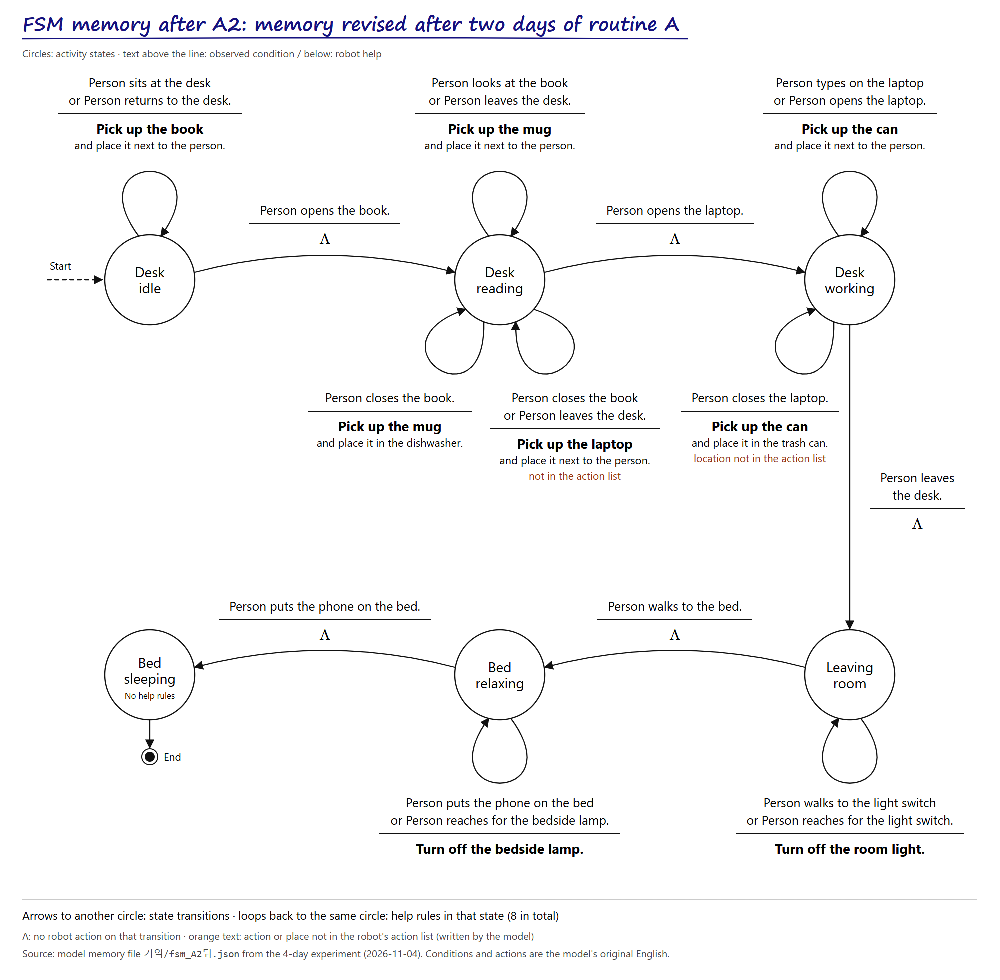
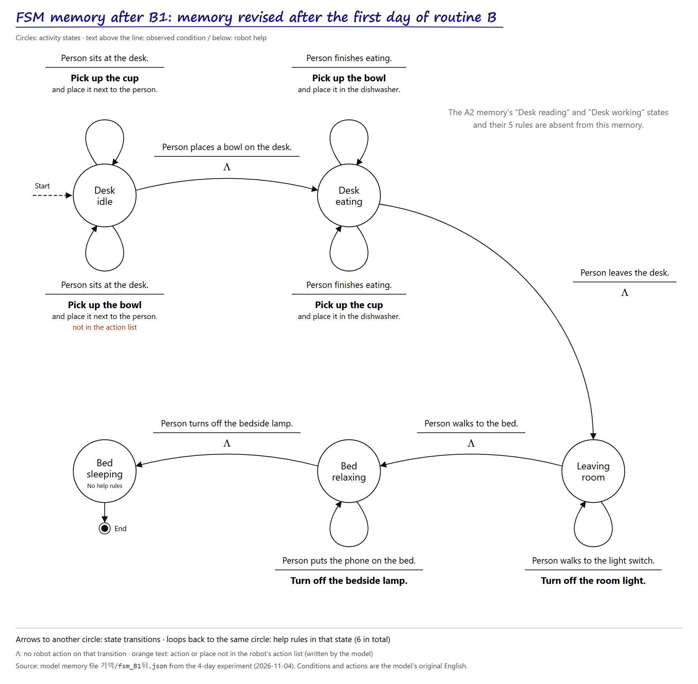

# Four-Day Routine Videos — Does Memory Really Help? (2026-11-04)

## Summary

I ran PAM on four days of routine videos I filmed myself. With memory, the action score rose sharply (0.41 vs. 0.04 on the second day), but when the routine changed, the old rules were erased, and the self-reflection did not look back on the robot's own mistakes.

## Why I ran this experiment

- I wanted to see whether PAM's memory helps on real daily-life videos, not only on synthetic scenes.
- I followed the paper's method as is, but judged that numbers such as the frame interval had to be re-chosen to fit our videos.
- I decided in advance what to measure.
  1. Does it build the right rules?
  2. Does it correctly revise rules after seeing how the person reacts to being helped?
  3. Does the trigger actually fire?

  In these videos the robot never actually helps, so I could not measure item 2. I handed item 2 over to the inverse planning line of work.

## What I filmed

| Day | Routine | Length | Sequence |
|---|---|---|---|
| A1, A2 | A night of reading and laptop work | 202 s, 215 s | Phone at desk → reading (cup) → laptop (can) → turn off light → phone in bed → turn off desk lamp |
| B1, B2 | A night of vitamins and eggs | 169 s, 182 s | Phone at desk → take vitamins (cup) → eat eggs (cup) → turn off light → phone in bed → turn off desk lamp |

- I filmed the desk, the light switch, and the bed with one camera and joined them into one video per day. The light-off scenes were filmed separately as extra takes.
- The order shown to the model was A1 → A2 → B1 → B2. After two days of the same routine, it switches to a different routine.
- For B2's bed scene, I reused the B1 footage as is.
- The videos and the frames extracted every second are not uploaded.

## Actions the robot can choose

At each moment the robot chooses one of the 10 actions below, or "do nothing." The robot does not actually move; it only chooses.

| Type | Actions |
|---|---|
| Bring (3) | book → next to the person, cup → next to the person, can → next to the person |
| Put away (4) | book → storage spot, cup → dishwasher, bowl → dishwasher, can → storage spot |
| Turn off (2) | turn off room light, turn off desk lamp |
| Deliberate wrong option (1) | desk lamp → storage spot (never needed in the videos) |

## How I built the answer key

- I went through the videos in 0.25-second steps and labeled one frame per second with "what the robot should do at this moment." Of the 768 frames across the four days, 347 are moments that call for an action.
- For bringing actions, I also score when the item was delivered. For example, A2's cup is on time if delivered at 28–60 s and late at 61–70 s. At 70.25 s the person brought it themselves, so if it had not been delivered by then, it counts as missed.
- The answer key was not given to the model. It is still an unfinalized draft (version 3).

## How I ran the experiment

- **Choosing an action every second.** Given the 9 frames from the last 9 seconds (1 s apart), the memory, and the action list, the model outputs a one-line scene description, a one-line reason, and one action. The model was Qwen3.5-27B with thinking turned off.
- **Self-reflection at the end of each day.** Given 200 frames from that day, the memory so far, and a summary of the day, the model outputs a revised memory. Thinking was turned on.
- **Where I departed from the paper.**
  - Frame interval: the paper uses 5 frames 2 s apart. The shortest cue in our videos lasts 0.5–1 s, so I switched to 9 frames 1 s apart.
  - Daily summary: built not from the event list measured by the evaluator, but from the scene descriptions the robot wrote every second. This keeps information that only the evaluator knows from leaking into the model.
- Requests with 200 frames at once exceeded the limits of the external model service, so I loaded the model myself onto a rented GPU server (RunPod H100) and ran it there.

## The three conditions I compared

Same videos, same model; only the form of the memory differs. On the first day, A1, all three conditions start with no memory.

- **No memory.** Chooses each time from that moment's frames only. No end-of-day reflection either.
- **FSM memory (the paper's method).** Groups rules by routine stage and also records the condition for moving on to the next stage.
- **List memory.** Just lists "condition → action" with no stages.

## Results

Action F1 (how well it matched; 1 is perfect)

| Day | FSM memory | List memory | No memory |
|---|---|---|---|
| A2 | 0.41 | 0.34 | 0.04 |
| B1 | 0.27 | 0.30 | 0.00 |
| B2 | 0.25 | 0.30 | 0.08 |

Time to the first correct action (seconds; shorter is better)

| Day | FSM memory | List memory | No memory |
|---|---|---|---|
| A2 | 3.9 | 3.3 | 13.0 |
| B1 | 11.2 | 10.8 | 12.7 |
| B2 | 5.5 | 12.0 | 12.5 |

- With memory, scores were higher than with no memory on all three days.
- Running the same input (A1) twice gave 0.04 and 0.15. So the gap between FSM memory and list memory (0.03–0.07) is within the range of chance, and I drew no conclusion from it.
- There were 0 malformed answers.

## The memory that was actually produced

The memory revised after two days of routine A. 6 stages, 8 rules.

The memory revised after the first day of routine B. "Bring a cup when the person sits at the desk" and "bring a bowl when the person sits at the desk" appeared, and routine A's "reading" and "laptop work" stages disappeared along with the 5 rules in them.

## What I found digging into the results

1. **When the routine changed, it erased the old routine's rules.** After the B1 reflection, the reading and laptop stages and their 5 rules disappeared. The model's thinking trace said, "today's video doesn't support them, so delete them." In the paper (Figure 7), the old stages remain even after the first day of a changed routine. List memory did not erase the routine A rules.
2. **Self-reflection did not see the robot's own mistakes.** The daily summary only said "the robot did not actually move," so in 0 of the 6 reflections did it look back on an action the robot chose and call it wrong. It did learn from what the person did themselves. The B1 reflection added "bring a cup when the person sits at the desk," and in B2 the robot chose the cup on time at 71 s.
3. **Rules formed from a single day misfired.**
   - A2: even though the can was already on the desk, it chose bringing the can 6 times, "following the laptop-work stage rule."
   - B2: while the person sat looking at their phone, it followed the "sits down → bowl" rule and chose the bowl action (13 s).
   - This problem led to the next question, "how do I tell chance apart from habit?" (the adoption test).
4. **It mistook a brief exit for the end of the day.** Because the memory had "leaves the desk → exiting (the stage of going to turn off the light)," it missed bringing the book and the can when the person briefly stepped out to get something (A2 16–27 s and 114–121 s, B1 15–26 s). The model does not store which stage it is in; it re-guesses every second from the last 9 frames.
5. **Rules produced actions the robot cannot perform.** Rules such as "bring the laptop," "bring a bowl," and "can → trash can" appeared. The rule-writing prompt does not include the action list (the same is true in the paper). "Trash can" was a mistake of ours, left over in the location list.
6. **A misread scene changed a rule.** When I traced why the cup rule was formed as "when sitting down" rather than "when starting to eat," I found that on the third day the scene descriptions had wrongly recorded "briefly gets up to fetch water" at 91–98 s as "finishes eating and leaves," so this event was missing from the nightly summary.

## Intended behavior (not an experiment result)

I judged it more natural to bring the cup "when the person starts eating" than "when they sit at the desk." So I edited the result by hand to sketch the intended behavior. This figure is not a result produced by the experiment.

## Limitations and next steps

| Limitation | Next step |
|---|---|
| Each condition was run only once (the same input gave 0.04 / 0.15) | Run several times and look at the mean and spread |
| The reflection model does not know which actions the robot chose | Add "actions the robot chose" to the daily summary |
| I only tested the order 2 days of routine A → 2 days of routine B | Interleave, e.g., A1 → B1 → A2 → B2, and see whether the old rules survive |
| Reactions after help (evaluation item 2) could not be measured | Handled under inverse planning |
| The answer key is an unfinalized draft | Finalize the answer key |

The "rules formed from a single day" problem seen here led to the adoption test (80% and chance probability), and judgment problems like the "brief exit" led to work on trigger criteria.

## Files

| Folder | Contents |
|---|---|
| `figures/` | Figures of the habit memory (FSM) actually produced (after A2, after B1) |
| `기억/` (memory) | Raw memory text produced each day (FSM memory, list memory) |
| `사진분석/` (frame analysis) | Logs of the judgment made every second (four days) |
| `점수/` (scores) | Scores by condition |
| `정답/` (answer key) | Answer key draft |

The videos and the frames extracted every second are not uploaded.
