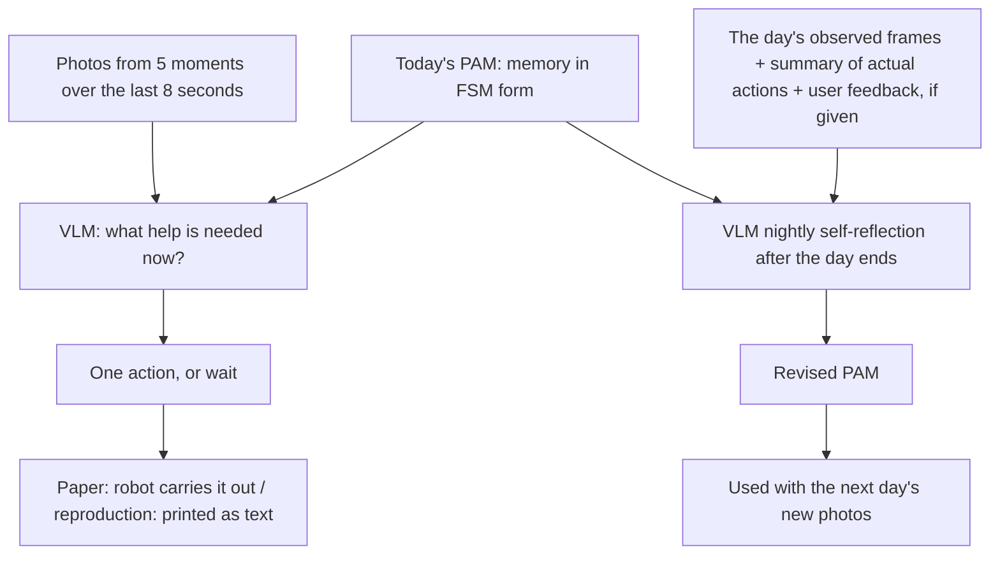

# The PAM paper, explained

This is a reader's guide to the PAM (Procedural Assistance Memory) paper, written while I was reproducing its method. It is not the authors' document and does not speak for them. It covers the problem the paper addresses, how the method works, what the paper reports, and where its limits are, with page numbers so each point can be checked against the original. Page numbers refer to arXiv v1.

- Paper: **An Agentic Framework for Proactive Robots with Procedural Assistance Memory**, Dohyun Lee, Minho Park, et al., KAIST AI, CoRL 2026. [Read the paper](https://arxiv.org/abs/2610.21211)
- Authors' public materials: [DAVIAN-Robotics/PAM](https://github.com/DAVIAN-Robotics/PAM)
- Versions checked: paper v1 and public repository commit `656a63ef4607177dd3b404042086486531a573f4`
- The reproduction is not the authors' official code. It was written from the paper and its appendix.

## The problem the paper addresses

**The paper's example is an empty bowl on a desk.**

| Situation in the paper | Help that is needed |
|---|---|
| The user is about to eat | Bring cereal |
| The user has finished eating | Put the empty bowl away |

Section 3.2 (p. 4) explains that the same empty bowl on the desk can call for bringing cereal or for putting the bowl away, depending on whether the user is about to start eating or has already finished. **Telling these apart requires knowing the user's current activity phase, not just the objects in view.**

Figure 1 (p. 2) shows a user arriving in the morning with a bowl. General intent prediction leaves it unclear whether the user wants oatmeal, cereal, or yogurt. But **a memory that this user has been eating cereal for breakfast lately** lets the robot choose to bring cereal.

The paper's approach, then, is to **remember the user's activity phases and repeated behavior, interpret the current observation in that context, and decide when to help and with what.**

## What are PAM, FSM, and VLM?

| Term | Plain meaning | Role |
|---|---|---|
| **PAM** — Procedural Assistance Memory | A habit memory of when to help and what help to give | Stores the user's activity phases, assistance conditions and actions, and the links between phases |
| **FSM** — Finite-State Machine | A structure that splits an activity into a few states and moves to the next state when a given event happens | The format PAM is organized in |
| **VLM** — Vision-Language Model | A model that understands images and text together | Reads recent photos together with PAM to choose an action, or revises the memory |
| **VLA** — Vision-Language-Action model | A model that turns images and an instruction into robot motions | Carries out the chosen task on the real robot in the paper. Not used in the reproduction, which prints the chosen action as text |

**PAM is the habit memory, FSM is the shape of that memory, and the VLM is the model that reads the memory and the photos.** The three terms should not be used interchangeably.

### What goes into the FSM?

Circles are states and arrows between circles are transitions. In each label, the text above the line is the condition and the text below is what the robot does; "Λ" means no robot action.

The figure below draws **the five states and five transitions of the paper's final memory after Day 5, from Figure 14 (p. 25) and Figure 18 (pp. 27–28)**. **All six assistance rules are drawn too, as loop arrows attached to their state**: four on Meal preparation, "put the empty bowl away" on Eating, and "throw away the used wet wipe" on Cleaning break.

> **Figure 3 versus the final memory:** Figure 3 in the main text (p. 4) draws typing on the laptop as `Cleanup → Eating`, but the final memory in Figures 14 and 18 has `cleaning_break → working`. The figure here follows the final memory and draws it as **Cleaning break → Working**. Whether the authors intended this or it is a slip has not been confirmed; the point is only that the two sources differ.


| Mark in the figure | Meaning | Example from the paper's final memory |
|---|---|---|
| Circle | An activity state of the user | Meal preparation, Eating, Working, Cleaning break, Leaving |
| Curved arrow to another circle | The next activity state, reached when its condition is observed | Person picks up a spoon → Meal preparation moves to Eating |
| Loop back to the same circle | Shows an assistance rule stored in that state. It is not an extra state transition | In Meal preparation, person places a bowl on the desk or sits down → bring cereal |
| Condition above the line / action below | Which observation leads to which help | Places a bowl on the desk or sits down / bring cereal |
| Dashed start arrow and end marker | Where the figure starts and ends. They are not extra activity states | Starts at Meal preparation; ends after Leaving |

**Λ (lambda) marks a transition that has no robot action written on it.** The final memory stores conditions on transitions and keeps assistance actions in per-state rules, so transitions carry Λ. It is not the symbol for the wait output the model actually produces.

Reading the figure: Meal preparation has the assistance rule **"if the person places a bowl on the desk or sits down, bring cereal."** After that, **picking up a spoon leads to Eating**, and **starting to type leads to Working**. While working, reaching for wet wipes leads to Cleaning break, and typing on the laptop after wiping leads back to Working. **Typing is not read as resuming the meal.**

The figure draws the assistance rules that the paper keeps inside each state as loops. The actual PAM stores per-state assistance rules and state transitions separately. A loop does not mean the action repeats automatically, and **bringing cereal is not itself the condition for moving to Eating.**

**Looking at the states alone is not enough; one also has to see which observation, in each state, triggers which help.** The six assistance rules of the paper's final memory are below. In each row, observing any one of the conditions joined by "or" makes the help a candidate; the deciding model also checks the current context and whether the help can be carried out right away.

| Current state | Trigger — what the person is seen doing | Help the robot gives |
|---|---|---|
| Meal preparation | Places a bowl on the desk **or** sits down at the desk | Pick up the cereal bag and place it next to the person |
| Meal preparation | Pours cereal into the bowl **or** places the cereal bag on the desk | Pick up the milk bottle and place it next to the person |
| Meal preparation | Reaches for the milk bottle **or** finishes pouring cereal **or** places the cereal bag on the desk | Put the cereal bag in the designated storage area |
| Meal preparation | Picks up a spoon **or** finishes pouring milk **or** places the milk bottle on the desk | Put the milk bottle in the designated storage area |
| Eating | Opens the laptop **or** puts down the spoon **or** places the empty bowl on the desk | Put the empty bowl in the designated storage area |
| Cleaning break | Starts typing **or** finishes wiping **or** places the used wet wipe on the desk | Throw the used wet wipe in the trash can |

**How is "finished eating" represented?** The final memory has no separate "meal finished" state. Within Eating, cues such as putting down the spoon or placing the empty bowl on the desk lead to the decision to **put the empty bowl away**. Starting to type then leads to Working. A design with "meal finished" as its own state is possible, but it is not the structure of the paper's final memory.

**Why is there a Cleaning break state?** It does not mean the robot wipes the person's hands. The short activity of the person using a wet wipe is remembered separately so that **typing again after using a wet wipe** can be told apart from other typing. Section C.2 (p. 23) and Figure 17 (p. 27) show the reflection model considering whether to fold wet-wipe handling into Working and then making it a separate phase. The help given in that phase is **throwing away the used wet wipe**.

**What help is given during Working?** In the final memory of Figure 18, the `rules` list (assistance rules) of Working is empty, and the same is true for Leaving. This means no help is registered for those states. It does not mean the robot may delete such a state, or that every state must have a rule. Working provides the context that leads into Cleaning break and Leaving. New help should be added only on the basis of the user's actual repeated behavior or feedback.

**How is this different from "bring wet wipes when the meal is finished"?** Such help could be designed. In fact, the **list memory in Appendix Figure 19 (p. 28)** contains a rule that brings the wet wipe package when the person types on the laptop, rests hands on the keyboard, or finishes eating. But Figure 19 is a **separate comparison method** with no states, and the final FSM memory of Figure 18 described here has no such rule. In addition, the six evaluation tasks in Figure 4 of the main text (p. 5) include "throw away the used wet wipe" but not "bring wet wipes." So a rule sentence generated in the appendix should not be read as that action being part of the final FSM or of the evaluation task set.

PAM stores this structure as structured text such as JSON (p. 4). The actual fields are `initial_state` (the starting state), `states` (the activity phases), `rules` (triggers and actions), and `next` (the conditions for moving to the next phase). A state may have no rules or several.

The paper does not, however, choose actions by having a program fix one current state and run its conditions. **The VLM reads the whole memory written in FSM form together with the recent photos and chooses the action that fits the current situation** (p. 4). The FSM supplies activity context for that judgment.

## How it works: decide during the day, revise the memory after the day ends



The day's observations and the **actions that actually happened** are recorded and used as input to self-reflection. In the reproduction, action suggestions printed as text are not recorded as actions the robot actually performed.

### During the day: choose an action from photos and memory

1. **Prepare recent photos.** Take five moments: 8, 6, 4, and 2 seconds ago, and now (p. 15). The left and right camera images from the same moment are placed side by side, so the model receives 5 combined images, or 10 original camera images.
2. **Send the photos together with PAM.** The list of possible actions and the instruction for the decision go with them. Evaluation ground truth is not sent.
3. **The VLM interprets whether help is needed and can be carried out.** It reads the people, objects, and actions in the photos together with the activity context in the memory.
4. **It outputs one action or wait.** The response format is checked, and the action number is shown as a readable sentence.

The paper uses Qwen3.5-27B for both the decision and self-reflection. The extra reasoning mode ("thinking") is turned off for the decision and on for self-reflection (p. 4; p. 16). The reproduction requests the same settings.

In the model's response, `observation` is a description of what is seen, `reasoning` is a short reason for the decision, and `task_index` is the number of the chosen action. `-1` means wait, the paper's NO_ACT (no help needed). In the reproduction, a broken or cut-off response is recorded as an error rather than turned into a wait.

### After the day ends: the VLM revises PAM through self-reflection

"Nightly" self-reflection is a plain way of saying that the log is reviewed after the day's activity ends. It does not mean the step runs automatically at a set time.

The self-reflection VLM receives the following:

| Input | Purpose |
|---|---|
| Photos sampled evenly from the day's recording | See how the person actually behaved |
| The PAM used today | Check the existing assistance rules and activity structure |
| A time-ordered summary of the person's and the robot's actions | Show who actually did what |
| User feedback, if any | Reflect help the user does or does not want |

The paper's setting is **200 frames** (p. 16). Building the first memory starts from the observed frames alone; this is separate from the updates that also use the previous memory, the action summary, and feedback.

The question self-reflection asks is not simply "what did the person do today?" It is **"Which of the things the person did by hand could the robot have done for them in advance, and which observation should trigger that help next time?"**

The example from §3.3 (p. 5), spelled out:

```text
Observation: the person brings out an empty bowl, then pours cereal themselves.
Review: could the robot have helped by bringing the cereal in advance?
Candidate new rule: when the person brings out an empty bowl → bring cereal.
```

The guidelines in the appendix ask the model to base rules on object movements that were actually observed, to use observation signals that the person will still produce even when the robot helps, and not to delete an existing rule just because it did not show up today. They tell the model to avoid conditions that defeat the purpose of helping in advance, such as bringing the milk after the user has already started picking it up. User feedback, when present, takes priority.

The output is not a written reflection but **the whole revised PAM**. It can add or change activity states, assistance conditions and actions, and the links between states. The model's weights are not retrained; what changes is the external memory the model reads. The paper does not present a separate training objective for optimizing the rules; the VLM updates the memory by following the instructions in the published prompts.

### The next day: read the revised memory again

PAM stays fixed during the day, and the new memory made after the day ends is used from the next day on. Reading new photos works the same way, but the memory consulted is different.

An example of memory change from the authors' public materials:

| Memory | Condition for bringing cereal |
|---|---|
| Public Day 1 example | Person places a bowl on the desk |
| Public Day 2 example | Person places a bowl on the desk **or sits down at the desk** |

The same Day 2 example also adds the rule **when cereal is poured into the bowl, bring milk**. These are the authors' published memory examples, not results learned in the reproduction.

Whether the right actions still come out after the memory is revised has to be checked separately. A revised rule alone is not evidence of better performance. If the log gives no reason for a change, keeping the memory as it is is also a valid outcome.

## What the paper reports

All numbers in this section are taken from the paper itself.

**Evaluation data.** One user performed the same morning desk routine on five separate days: arrive with a bowl, pour cereal and then milk, eat, set the bowl aside and work on the laptop, wipe with a wet wipe and leave it on the desk, then leave (A.1, p. 15). Each day's recording lasts roughly 3.5 to 4.5 minutes. Sampling one frame per second gives 197 to 270 frames per day and **1,146 annotated frames in total** (p. 15; Table 2, p. 16). The authors labeled every frame by hand with one of the six tasks or NO_ACT; 673 of the 1,146 frames are NO_ACT (Table 2, p. 16).

**What is measured.** Each frame is treated as a classification: one of the six tasks, or NO_ACT. The paper reports precision (of the times the model chose a task, how often it was the right one), recall (of the frames that needed a task, how many the model caught), and F1 (one score combining the two, where 1 is perfect), per class and averaged (p. 6). First-fire delay is the time from the moment help should start until the model first predicts that task; if the model never predicts it, the delay runs until the user finishes the task without the robot (p. 6).

**Results over the five days** (Figure 5, p. 6; §4.2, p. 7):

- The baselines without memory (LIT, an event-driven VLM, and a zero-shot VLM) stay conservative. When the scene is ambiguous they fall back to NO_ACT, so they rarely offer help. LIT and the event-driven VLM have near-zero recall on the six tasks, and the zero-shot VLM levels off from Day 2.
- With FSM memory, results improve across the days. It reaches the highest precision, recall, and F1 on the six tasks, and **first-fire delay drops from roughly 5 seconds on Day 1 to about 1 second by Day 5** (also stated in the abstract, p. 1).
- A variant that keeps the rules as a flat list instead of an FSM (list memory) stops improving early. The authors read this as showing that the gain comes from the FSM structure, not only from having memory.
- The cost is that FSM memory is eager to act, so its NO_ACT recall is lower than that of the conservative baselines. Its NO_ACT precision is higher, which keeps its NO_ACT F1 on par with the others.
- The averaged results are shown only as plots (Figure 5, p. 6). Per-task numbers are in Tables 3–5 (pp. 19–21).

**Adapting when the routine changes** (§4.3, p. 8; Figure 6, p. 7). The user switches from the cereal routine (Scenario A) to a different routine (Scenario B, Figure 20, p. 28); for example, the user takes vitamins instead of eating cereal. Both memory conditions below start from Scenario A's Day 5 memory.

- On the first day of the new routine, the memory that keeps being revised (A-Evolving) has lower task recall and F1 than the zero-shot VLM. The old memory causes confusion at first.
- **After a single self-reflection at the end of that day**, its recall and F1 on Day 2 are comparable to those of a memory built from scratch on the new routine (Scratch-Evolving), and they stay close on later days. First-fire delay also decreases with continued reflection.
- The same old memory kept frozen (A-Frozen) stays below the zero-shot VLM.

**Carrying out the tasks** (Table 1, p. 9). The paper's full system, in which the VLM chooses the task and a VLA called π0.5 (fine-tuned on 10 demonstrations per task, p. 6) carries it out, is compared with π0.5 alone, fine-tuned on 10 recordings of the whole routine, with and without a reasoning step (p. 7). Successes out of 10 per task:

| Method | Bring cereal | Bring milk | Put cereal away | Put milk away | Put bowl away | Throw away wet wipe |
|---|---|---|---|---|---|---|
| π0.5 | 7/10 | 1/10 | 6/10 | 0/10 | 5/10 | 4/10 |
| π0.5 with reasoning | 6/10 | 0/10 | 0/10 | 0/10 | 5/10 | 5/10 |
| Paper's system | 9/10 | 3/10 | 8/10 | 5/10 | 8/10 | 8/10 |

**Speed.** One decision call takes about 1 second, and one self-reflection call about 1 minute (p. 6; p. 16).

## Limitations of the paper

### Limitations the authors state (p. 9, Limitation)

**Observed behavior may not reflect actual intent.** If the user only briefly handles an object tied to a learned trigger, the model may read it as the start of the next step and offer help. This leads to unneeded intervention in situations where doing nothing would have been right.

**Cutting false alarms is left open.** On p. 7 the authors note that FSM memory's readiness to act lowers how often it correctly waits, and they describe reducing such false alarms further, without losing proactiveness, as an open direction for future work.

**There is no way to check with the user when things are unclear.** The authors say that in such cases asking the user may be better than acting, but that asking for clarification is outside the current framework. PAM should therefore not be read as removing all ambiguity.

**Generalization to new objects, layouts, and users is barely tested.** The authors say that, because of the limited ability of current open-source VLAs, the evaluation is restricted to scenarios already seen. This does not mean the method will fail in every new situation, but it also does not show that it can be applied directly in varied real homes.

### Further points from reading the setup — this guide's interpretation

The points below are not the authors' words; they are observations based on the conditions described in the paper.

| Point | Basis in the paper and what it means |
|---|---|
| Scope of repeated, long-term evaluation | The main 5-day desk evaluation in A.1 (p. 15) uses one user's repeated routine, and each day's recording is about 3.5 to 4.5 minutes. It is hard to extend this to long-term use in real homes. |
| Immediate correction for sudden habit changes | §3.3 (p. 5) keeps the memory fixed during the day and updates it after the day ends. Changing the memory right away when a new preference appears during the day is not provided by this update cycle. |
| Errors in reading photos and revising memory | §3.2–3.3 (pp. 4–5) rely on the VLM's interpretation and generation. Even with the right memory, the model can misread a scene, and no mathematical guarantee is given that the generated rules are correct. |

## Checking the evidence

- Paper §3.1–3.3, pp. 4–5: the decision step, PAM, and the end-of-day memory update
- Paper A.1–A.2, pp. 15–16: scope of the evaluation recordings, and input and model settings
- Paper Appendices E and F, pp. 31–40: the actual prompts for the decision, memory building, and memory updates
- Paper p. 9, Limitation: the authors' own points on unneeded intervention, the lack of a way to ask the user, and the limited generalization testing
- [Paper-fidelity verification report](notes/sources/논문충실도_검증보고서.md): comparison with the original text, checks that were run, implementation changes, and remaining limits
- [Source map of the original prompts](prompts/source_map.json): where each prompt was transcribed from, and file hashes
- [Sources of public materials](THIRD_PARTY.md): what was written for the reproduction and what comes from the authors

## Where our experiments are

- [README.md](README.md): my research overview
- [notes/02_pam-reproduction.md](notes/02_pam-reproduction.md): how the paper's method was reproduced from the paper and its appendix
- [2026-11-04_four-day-routine-videos/](2026-11-04_four-day-routine-videos/): the first run, on real video, of the full loop of deciding during the day, nightly self-reflection, and using the revised memory the next day
- [notes/08_adoption-test.md](notes/08_adoption-test.md): the adoption test, which accepts a trigger candidate as a rule only if the task follows it often enough and it is unlikely to be chance
